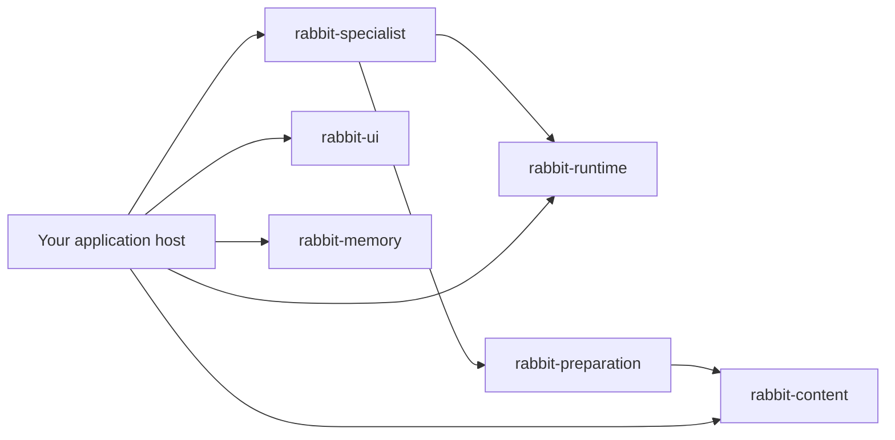

# Architecture · 模块结构

[English overview](README.md) · [中文介绍](README.zh-CN.md)

White Rabbit is an assembly of reusable cores around one local application host. The goal is that a useful part can be installed, understood, replaced, or developed on its own. An application using the content or memory core should not have to adopt the White Rabbit chat server.

The host owns shared transactions, the chat catalog, HTTP, orchestration, and lifecycle. Native agents own their original sessions, tool loops, credentials, and permission decisions. Packaging does not turn the system into seven services or seven databases.

Application ledgers also have their own data scope. The Claude operation ledger can freeze a successful, non-truncated, top-level SDK final answer of at most 128 KiB alongside its original request identity and SHA-256. Exact reads can use that saved body after disconnect/rebuild and identify it as `stored_sdk_result`, without claiming a live owner. Older records without bodies are not reconstructed; legacy read-only V1 ledgers are not migrated by result lookup, and invalid or mismatched evidence is rejected. These ledgers are private runtime data, not public source files. Full original transcripts and internal session state remain owned by the native agent.

## Seven responsibilities, six installable cores

| Responsibility / 职责 | Extracted core | What remains with the host |
| --- | --- | --- |
| 1. Content / 内容存储与管理 | [`rabbit_content`](原型/rabbit_content/README.md): versioned text and image materials, publication receipts, Markdown organization | Chat storage, history indexing, and their shared transaction/scheduling boundaries |
| 2. Preparation / 内容准备 | [`rabbit_preparation`](原型/rabbit_preparation/README.md): context selection, material validation, and handoff packaging | Reading actual sources and retrieving selected memory |
| 3. Runtime / Agent 接入与运行 | [`rabbit_runtime`](原型/rabbit_runtime/README.md): process transport, Codex execution, Pi/DSH/Claude/Hermes foundations, optional HAPI work reader | Upper-level send coordination, profiles, material/memory assembly, HTTP, and manual external-work binding |
| 4. Memory / 长期记忆 | [`rabbit_memory`](原型/rabbit_memory/README.md): profiles, source bindings, bounded transports and write jobs | Driver configuration, background scheduling, admission, and chat transactions |
| 5. UI / 用户端展示 | [`rabbit_ui`](原型/rabbit_ui/README.md): assets and page assembly | Compatible same-origin business APIs, validated agent definitions, and security headers |
| 6. Remote I/O / 远程输入输出 | No extracted package; current phone access uses external IM.codes | Device connectivity and the future multi-device route |
| 7. Specialist / 小白兔专员 | [`rabbit_specialist`](原型/rabbit_specialist/README.md): fixed role connection, work-description preparation, and bounded task coordination | Module business interfaces, actual management service, display, and target availability |

Six packages have independent directories, versions, and `pyproject.toml` files. They do not import the White Rabbit host. Parts of responsibilities 1, 2, 3, 4, and 7 still require host assembly; six packaged cores do not mean all seven responsibilities are fully separated.



*Arrows between packages are declared Python dependencies. The host-to-core arrows are an example assembly, not mandatory dependencies between every part.*

## Reuse one core

Use **Python 3.11+**. From this checkout, install a complete package directory, including its metadata and bundled notices:

```sh
python3 -m pip install ./原型/rabbit_content
```

A small application can use the content store without starting White Rabbit or an agent:

```python
from pathlib import Path
from tempfile import TemporaryDirectory
from uuid import uuid4
from rabbit_content import FileTaskStore

with TemporaryDirectory(prefix="rabbit-content-example-") as directory:
    with FileTaskStore(Path(directory).resolve()) as store:
        source = store.add_source(
            "brief.md", "# Project brief\n\nAn invented example.\n",
            {"kind": "upload"}, str(uuid4()),
        )
        snapshot = store.input_snapshot(source["id"], expected_sha256=source["sha256"])
        print(snapshot["text"])
```

Text capabilities use the standard library. Optional image operations need the package's `images` extra. File-locking/safe-directory operations target macOS/POSIX; the preserve-original Markdown exchange update is macOS-specific.

The UI core can also provide a resource to another compatible host:

```sh
python3 -m pip install ./原型/rabbit_ui
```

```python
from rabbit_ui import read_resource

resource = read_resource("/style.css", agent_bootstrap="")
print(resource.content_type, len(resource.data))
```

Serving these assets is not a standalone chat backend. The embedding host supplies the compatible HTTP APIs and corresponding security headers.

## Install cores with local dependencies

`rabbit-preparation` depends on `rabbit-content`; `rabbit-specialist` depends on runtime and preparation. Pass all required **local directories** to pip together, rather than asking PyPI for unpublished White Rabbit packages:

```sh
python3 -m pip install \
  ./原型/rabbit_content \
  ./原型/rabbit_preparation \
  ./原型/rabbit_runtime \
  ./原型/rabbit_memory \
  ./原型/rabbit_ui \
  ./原型/rabbit_specialist
```

No native agent is installed or started by this example. The runtime foundation is standard-library based; the Claude worker separately needs its supported official SDK environment and a matching installed runtime distribution. Optional providers, image libraries, build tools, and services have their own dependencies.

## Keep the boundaries real

1. **One owner for each rule and record.** UI actions and specialist tools call the same versioned business interfaces. The specialist has no parallel settings database.
2. **Explicit inputs.** Embedding applications provide roots, source readers, identities, snapshots, and capabilities. A core should not search for private host data just because it was imported.
3. **Execution stays native.** Transport and adapters connect mature agents; the application does not copy their execution loop or treat a text response as full native integration.
4. **Evidence keeps its scope.** History reading, saved-session recovery, and attachment to a live external executor are distinct. HAPI summaries are Hub reports, not authoritative observations of all native work.
5. **Unknown stays unknown.** A timeout, cached status, or recent answer does not establish which request completed. Preserve original IDs and receipts; do not resend an uncertain task.

## Where to work

| Change | Entry points |
| --- | --- |
| UI and color semantics | `原型/rabbit_ui/assets/`, [design guide](docs/design.md) |
| HTTP and host assembly | `原型/server.py` |
| Chat/profile/history records | `原型/chat_store.py`, `原型/profiles.py`, `原型/history_sources.py`, `原型/history_view.py` |
| Materials and input preparation | `原型/rabbit_content/`, `原型/rabbit_preparation/` and explicit host adapters |
| Native execution and external summaries | `原型/rabbit_runtime/`, host native coordinators, `原型/external_work.py` |
| Fixed connection paths | `原型/native_startup.py`, arguments in `原型/server.py` |
| Specialist and management interfaces | `原型/rabbit_specialist/`, `工具/rabbit_management_*`, [specialist guide](docs/specialist.md) |
| Fictional demo | `demo.py` |

## 中文：独立不是只分文件夹

每块核心都有自己的目录、版本和安装元数据，公开接口明确接收所需输入。需要哪块就从本地源码安装哪块，不必运行整个小白兔；上面的内容快照例子不启动聊天服务器或 Agent。

准备包依赖内容包，专员依赖运行包和准备包。一起安装时把相应本地目录传给同一次 pip 命令，避免去 PyPI 寻找本项目未发布的包。完整模块的许可证、资源与协议文件要一起保留，不只拷一个 Python 文件。

当前是七项职责、六个已拆核心，仍有宿主装配。严格模块化是持续要求：数据归属清楚、规则只有一份、接口有输入输出和失败状态、替换一块尽量不改其他块。不为拆包增加常驻服务，也不拆散必要的共同事务。模块技术 README 目前主要使用中文。

运行账本也有独立的数据范围：Claude 可以在本机按原请求身份与 SHA-256 冻存成功、未截断的顶层 SDK 最终回答，最多 128 KiB。断开／重建后的准确读回标为存储结果，不证明当前有活执行者；旧无正文回执不补造，旧 V1 只读账本不会因查询而迁移，损坏或身份不符时拒绝。账本属于私人运行数据，不进入公开源码；完整原生历史与内部状态仍归原 Agent。
