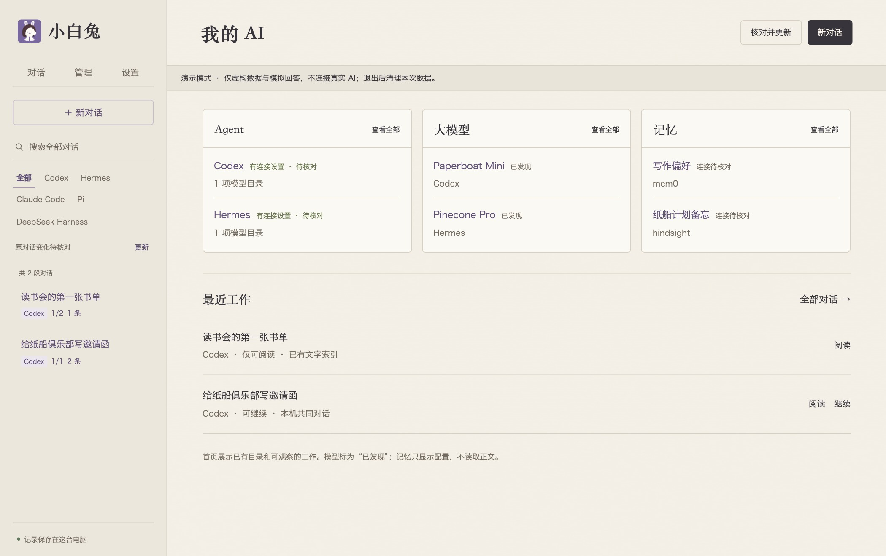
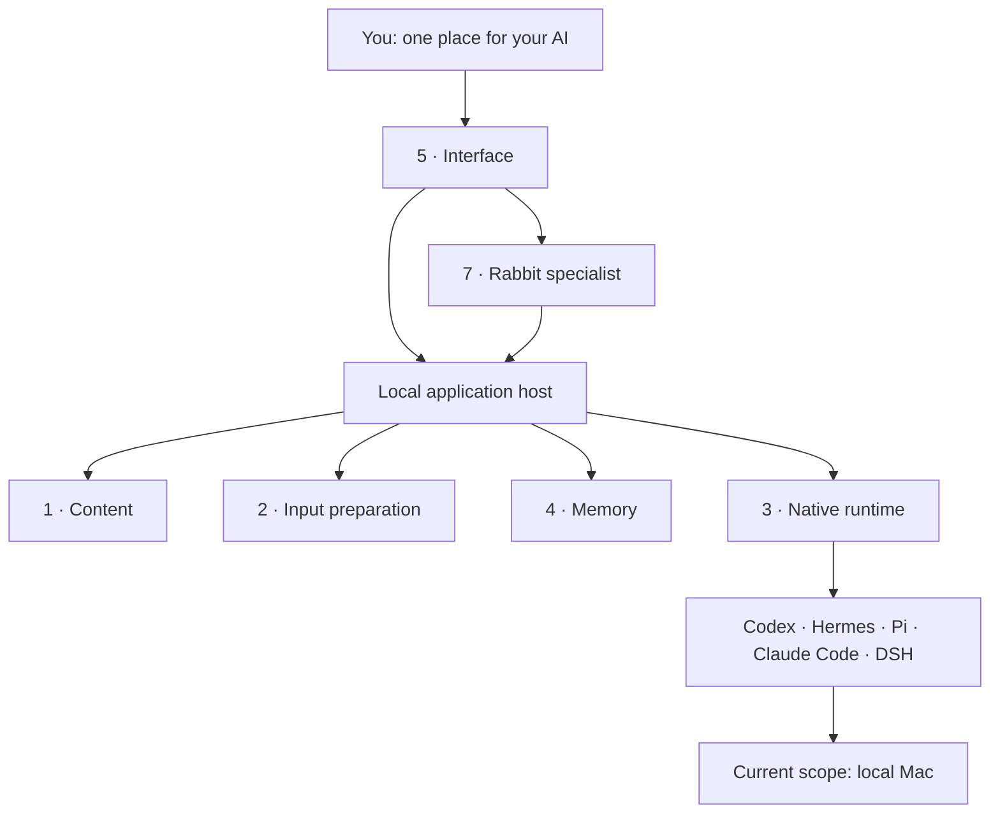
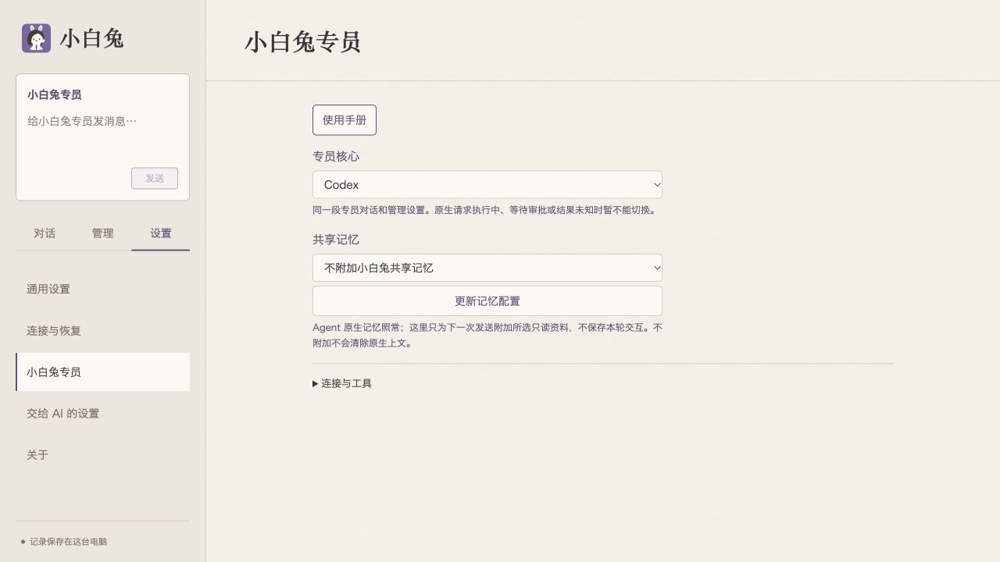
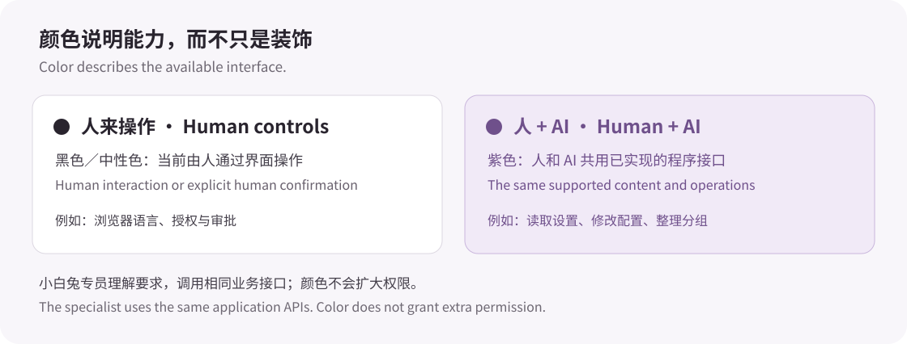
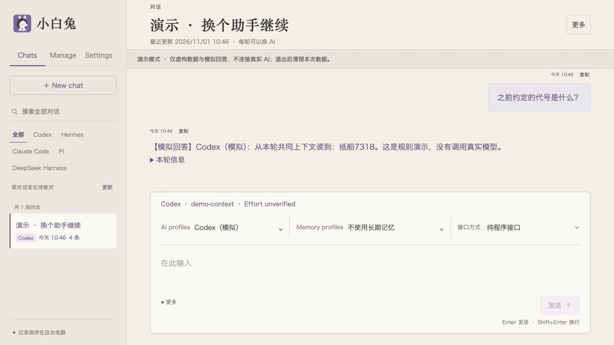

# White Rabbit · 小白兔

[English](README.md) · [简体中文](README.zh-CN.md)

[](https://github.com/icecinz/white-rabbit/actions/workflows/ci.yml)


**All your AI, in one place.**

White Rabbit brings agents, models, conversations, materials, and memory into a local workspace. It is for people who use several AI tools: find yesterday's work, choose who to work with next, and carry selected material forward without explaining the whole project again.

“All” describes the direction. The current application has experimental native routes for **Codex, Hermes, Pi, Claude Code, and DeepSeek Harness (DSH)** on one Mac. Each keeps its own supported models, tools, sessions, and approvals; the application does not make every model interchangeable with every agent.

**0.2.0-alpha.1 · Blueprint 2.0 early source snapshot.** My AI brings resources and recent work together; the specialist can use Codex or DSH within one application history. Connection requirements and supported operations remain agent-specific. Configure a native agent you already use, then verify a real reply and same-conversation continuation in your own environment.

**Early development release · macOS/POSIX · Python 3.11+**. The interface is still mainly Chinese; English covers basic navigation, management, and settings labels. Documentation is available in both languages.

**Installing for the first time?** Start with the [beginner guide](docs/getting-started.md). You can download the source ZIP and ask an assistant with local file and command access to help. There is no double-click app installer yet. You need a Mac, Python 3.11+, and one already configured native agent; a web-only chat cannot perform local installation. The fictional demo is a separate interface preview.



*Running application with invented resources and work, not a design mockup. Configure and verify it in your own environment.*

## What you can do

- **See your AI and recent work:** My AI summarizes agents, discovered models, memory profiles, and recent work. Open a resource's management details, continue a supported conversation, or read its exactly bound saved text.
- **Continue native-agent work:** use experimental connections for Codex, Hermes, Pi, Claude Code, and DeepSeek Harness, preserving their native sessions, tools, and approval rules.
- **Find and organize project material:** search indexed histories, group related conversations, and keep Markdown references or snapshots alongside files and results.
- **Continue between Codex and Hermes:** preview selected text, complete registered files, and original images as fixed snapshots. Prepare a draft first; only Send creates the new native conversation, with a route back to its source.
- **Choose AI and memory separately:** saved AI profiles describe agent/model settings; memory profiles independently select additional long-term material.
- **Ask the Rabbit specialist:** enable one management conversation and choose Codex or DSH as its core. Both use the application's supported management interfaces; ordinary-agent support and specialist-core support are tracked separately.
- **Reuse the parts:** take an independently packaged core into another Python application without adopting the entire White Rabbit host.

Each route retains its own sending, approval, and recovery protocol. Codex supports per-draft/per-conversation model and reasoning adjustments; a specialist draft-adjustment suggestion counts as applied only after the originating browser saves it and returns a receipt. Other management changes use the corresponding interface result and readback. Claude selects models without overriding native reasoning; DSH model changes remain unavailable, while its read-only memory selection is supported. [Daily workflow](docs/native-agents.md#daily-workflow)

## The idea and the current scope

| Area | Available in the current implementation | Still a goal or limited |
| --- | --- | --- |
| Ordinary AI conversations | Native routes for Codex, Hermes, Pi, Claude Code, and DSH | Login, model access, tools, attachments, and recovery are agent-specific; this is not universal support |
| Specialist core | Codex and DSH share one application history while retaining separate native sessions; both use supported management interfaces | Tool/model availability depends on the native setup. DSH specialist shared-memory selection is unconnected; Hermes is a later option. Switching is not complete native-state migration |
| Find existing work | My AI resource summaries and exact-item navigation; supported continuation and saved-text reading | Overview uses saved/cached facts and can remain unverified; direct control of ongoing external desktop tasks is not connected |
| Open in the original application | Existing local Codex links identify the original thread | System handoff and the installed target application need verification in each environment. Other agents have no general opening guarantee; opening is navigation, not control of a live task |
| External work discovery | Optional, manual HAPI Hub discovery and links to the original session page | HAPI sending, approvals, and stopping remain in HAPI; discovery is not control |
| Context and memory | Codex ↔ Hermes continuation with selected materials; Hindsight and separate Hermes document-memory routes | Continuation does not migrate internal agent state; Mem0 still needs configuration and has no automatic saving |
| Human and AI operations | Shared application interfaces, versioned settings, and the dedicated specialist | GUI-only application operation and AI/mixed interface modes are not connected |
| Product scope | Local Mac; device, wake-up, phone-preview entries and IM.codes-specific compatibility removed from this source snapshot | Historical phone access was not cross-device AI control; cross-computer takeover and wake-up were never implemented |

Opening **My AI** reads existing directories, indexes, and cached execution facts. It does not start an agent, send a probe message, or read memory content. A discovered model is not a tested model, and unobserved external work is not assumed idle. Start with **New conversation**, or use **Connect your first agent** when nothing is connected; the rabbit icon returns to the overview.



*Six active core responsibilities keep their existing numbers. Former module 6, Remote I/O, is historical; it is not another runtime package.*

## A specialist instead of more settings buttons

The **Rabbit specialist** manages White Rabbit through the same application interfaces as the UI; each module still owns its data and rules. Its continuous application history can use **Codex or DSH**, with a separate native session and received-text position for each core. It uses the existing native login and configuration, not a second settings system.

Choose the core in **Settings → Rabbit specialist**. Missing conversation prose is supplied to the selected core; historical tool calls remain records and are not replayed as commands. A successful switch adds one boundary in the same history. Busy, pending-approval, unknown-result, and capacity conditions block switching; a failed target connection retains the previous core, history, and draft. Keep the original operation ID when a switch or send is uncertain; do not replay a command to discover its outcome.



*Running application with invented resources and work, not a design mockup. Configure and verify it in your own environment.*

You can ask, for example:

- “Use project memory read-only for this conversation's next turn.”
- “Find the conversation named Project discussion; don't send a message.”
- “Move this conversation's organizing document into the existing Work group.”
- “Show replies as raw text instead of formatted Markdown.”

Some infrequent settings are presented as a readable catalog with current values and examples, rather than another row of switches. Ask the specialist to apply a supported change. It reads the current version, uses the bounded interface, and reports the outcome. Login, authorization, and native approvals still belong to the person using the application.

**Check and update** is a separate manual report: the program gathers four scoped metadata facts, an available tool-free text connection analyzes that frozen evidence once, and the application saves the report with its sources. Refreshing reads that report instead of rerunning the analysis; changed or missing evidence remains marked. Analysis uses the existing Claude-configured text adapter, separately from the chosen management core. The current specialist-tool fact observes the Codex-side holder; it does not certify all DSH tools. The report does not change settings or test every model/tool. [How the report works](docs/specialist.md#manual-status-report)

[Meet the specialist](docs/specialist.md)

## Color explains who can operate an item



| Appearance | Meaning |
| --- | --- |
| **Purple** | People can read/use the item, and a supported programmatic path lets AI read or perform the corresponding operation. Read-only content can be purple too. |
| **Black / neutral** | The current path is a human-facing interface or a confirmation that still needs a person. Dark themes use readable neutral colors. |

Color describes an available interface. It grants no additional permission and does not prove an action has run. The same boundary applies to the whole entry, not just its button. [Design principles](docs/design.md)

## Install with a real agent

Follow the [beginner guide](docs/getting-started.md) for downloading the ZIP, asking a local assistant to install it, checking real chat, and opening it later. The [installation checklist](docs/install-agent.md) and root [AGENTS.md](AGENTS.md) are for the assistant or a command-line user. The specialist and extra memory services are optional.

After installation, open Finder, press **Command + Shift + G**, enter `~/.imcodes/one-ai`, and double-click **打开小白兔.command**. Your installing assistant can create a desktop alias; the installer does not create one automatically. The legacy directory name does not require IM.codes.

White Rabbit's program and data live in that directory. Keep the source folder for documentation and updates, and preserve saved connections and conversations. Persistent installation supports macOS; other POSIX systems have only a manual foreground route. Windows is unsupported.

## Interface preview only: fictional demo



*A separate rule-based preview; it does not call a real agent.*

```sh
git clone https://github.com/icecinz/white-rabbit.git
cd white-rabbit
python3 -B demo.py
```

With **Python 3.11+**, open <http://127.0.0.1:17862/>. No key, model, or agent installation is needed. If the port is occupied, use `python3 -B demo.py --port 17863`.

1. Search for `纸船` (paper boat) and find the invented code `7318`.
2. Open the prepared chat and ask `之前的代号是什么？` (What was the earlier code?).
3. Switch between simulated Codex and Hermes profiles, ask again, then inspect **更多 → 查看本轮上下文** (More → View context for this turn).

The demo does not read native histories or contact a model. It uses a temporary directory; **Ctrl+C** cleans it up on normal exit. Use [real-agent mode](docs/native-agents.md) for persistent work with your own installed agents and credentials.

## Use a core in your own project

There are **six extracted, installable cores**: content, preparation, runtime, memory, UI, and specialist. Each has its own directory and `pyproject.toml`; the remaining host assembly is explicit. The original numbering is retained, with Remote I/O as historical module 6, not a seventh installable package. The new application-specific specialist coordinator still requires host adapters; independently reusable interfaces and host integration are listed separately.

For example, install only the content core from this checkout:

```sh
python3 -m pip install ./原型/rabbit_content
```

It provides file snapshots, content storage, publication receipts, and Markdown organization without the chat server. [Architecture and reuse examples](ARCHITECTURE.md) describe dependencies, interfaces, and what the embedding application supplies.

## Boundaries worth knowing

- Native history reading, saved-session recovery, and control of a live external task are different capabilities. One working CLI route does not establish desktop-application takeover.
- A handoff carries selected text and compatible materials, not another agent's complete internal state. Agent/model combinations, images, recovery, and tools need route-specific validation.
- Real mode reads local agent sources and can launch agents. Data sent to online models leaves the machine through the selected provider; there is no independent cloud backup here.
- Unknown send results retain their original request identity and are checked, rather than automatically resent. Eligible Claude final replies can be stored locally; Pi/Hermes complete results are saved after their first exact successful read. Missing or interrupted results are not reconstructed.
- Windows, automatic Markdown-body synchronization, and complete native feature/performance equivalence are not current release promises.

[Architecture](ARCHITECTURE.md) · [Design](docs/design.md) · [Specialist](docs/specialist.md) · [Native agents](docs/native-agents.md) · [Roadmap](ROADMAP.md) · [Changelog](CHANGELOG.md) · [Contributing](CONTRIBUTING.md)

[A note from the remote-access experiment](docs/history/remote/README.md)

White Rabbit's own code uses the [MIT License](LICENSE). Bundled components retain their original notices; see [third-party notices](THIRD_PARTY_NOTICES.md).
