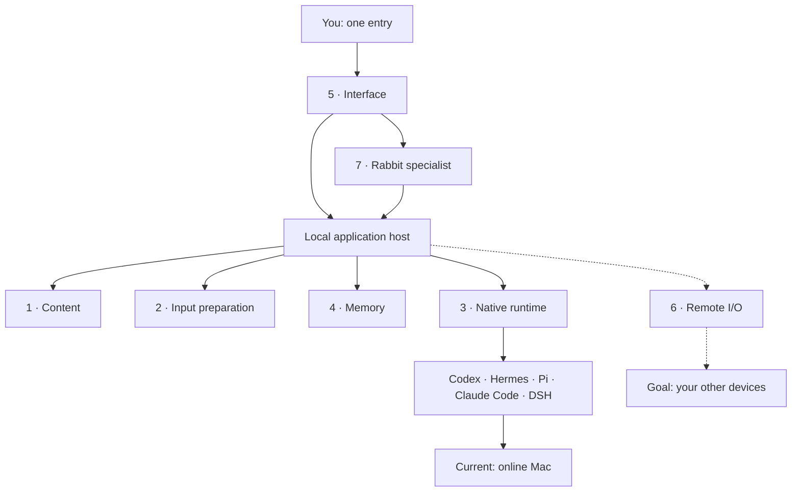

# White Rabbit · 小白兔

[English](README.md) · [简体中文](README.zh-CN.md)

[](https://github.com/icecinz/white-rabbit/actions/workflows/ci.yml)


**One entry for your AI work. A path toward working across your devices.**

White Rabbit brings native-agent work, conversations, materials, and memory into a local workspace. Choose the agent and model for the task, continue a supported session, inspect its progress, and keep the work organized without starting from scratch each time.

The longer-term aim is one place to reach your AI agents and the devices where they work. The current application focuses on **one online Mac** and the native connections it owns. Connecting arbitrary work already running in external desktop applications is still an open part of that goal.

**Early development release · macOS/POSIX · Python 3.11+**. The interface is still mainly Chinese; English covers basic navigation, management, and settings labels. Documentation is available in both languages.


*Invented demo conversations and explicitly marked, rule-based replies. This screenshot is not evidence of real model performance.*

## What you can do

- **Continue native-agent work:** use experimental connections for Codex, Hermes, Pi, Claude Code, and DeepSeek Harness, preserving their native sessions, tools, and approval rules.
- **Find and organize project material:** search indexed histories, group related conversations, and keep Markdown references or snapshots alongside files and results.
- **Carry forward selected context:** preview messages and versioned files before handing them to another agent. Compatible images depend on the route and model.
- **Choose AI and memory separately:** saved AI profiles describe agent/model settings; memory profiles independently select additional long-term material.
- **Ask the Rabbit specialist:** use a dedicated management conversation to change supported settings, organize work, or hand a task to an existing native conversation.
- **Reuse the parts:** take an independently packaged core into another Python application without adopting the entire White Rabbit host.

## The idea and the current scope

| Area | Available in the current implementation | Still a goal or limited |
| --- | --- | --- |
| One entry for AI work | Five native-agent routes; status and navigation for White Rabbit's own connected work | Direct control of ongoing Codex desktop or WorkBuddy tasks is not connected |
| External work discovery | Optional, manual HAPI Hub discovery and links to the original session page | HAPI sending, approvals, and stopping remain in HAPI; discovery is not control |
| Context and memory | Explicit materials; Hindsight and separate Hermes document-memory routes | Mem0 is an optional read-only bridge needing configuration; automatic Mem0 saving is not connected |
| Human and AI operations | Shared application interfaces, versioned settings, and the dedicated specialist | GUI-only application operation and AI/mixed interface modes are not connected |
| Devices | Local Mac; phone access through a separately configured IM.codes route | Cross-computer routing, device management, and remote wake-up remain future work |



*Dotted lines show the broader device goal. The existing mobile route opens the same Mac service through IM.codes.*

## A specialist instead of more settings buttons

The **Rabbit specialist** has one fixed native Codex conversation. It uses the same application interfaces as the UI; each module still owns its data and rules. It does not maintain a second settings system.

You can ask, for example:

- “Use project memory read-only for this conversation's next turn.”
- “Find the conversation named Project discussion; don't send a message.”
- “Move this conversation's organizing document into the existing Work group.”
- “Show replies as raw text instead of formatted Markdown.”

Some infrequent settings are presented as a readable catalog with current values and examples, rather than another row of switches. Ask the specialist to apply a supported change. It reads the current version, uses the bounded interface, and reports the outcome. Login, authorization, and native approvals still belong to the person using the application.

[Meet the specialist](docs/specialist.md)

## Color explains who can operate an item


| Appearance | Meaning |
| --- | --- |
| **Purple** | People can read/use the item, and a supported programmatic path lets AI read or perform the corresponding operation. Read-only content can be purple too. |
| **Black / neutral** | The current path is a human-facing interface or a confirmation that still needs a person. Dark themes use readable neutral colors. |

Color describes an available interface. It grants no additional permission and does not prove an action has run. The same boundary applies to the whole entry, not just its button. [Design principles](docs/design.md)

## Try the fictional demo

```sh
git clone https://github.com/icecinz/white-rabbit.git
cd white-rabbit
python3 -B demo.py
```

With **Python 3.11+**, open <http://127.0.0.1:17862/>. No key, model, or agent installation is needed. If the port is occupied, use `python3 -B demo.py --port 17863`.

1. Search for `纸船` (paper boat) and find the invented code `7318`.
2. Open the prepared chat and ask `之前的代号是什么？` (What was the earlier code?).
3. Switch between simulated Codex and Hermes profiles, ask again, then inspect **更多 → 查看本轮上下文** (More → View context for this turn).

The demo does not read native histories or contact a model. It uses a temporary directory; **Ctrl+C** cleans it up on normal exit. Use [real-agent mode](docs/native-agents.md) for persistent work with your own installed agents and credentials.

## Use a core in your own project

There are **seven responsibilities and six extracted, installable cores**. Content, preparation, runtime, memory, UI, and specialist each have their own directory and `pyproject.toml`; the remaining host assembly is explicit. Remote I/O is not a seventh extracted package.

For example, install only the content core from this checkout:

```sh
python3 -m pip install ./原型/rabbit_content
```

It provides file snapshots, content storage, publication receipts, and Markdown organization without the chat server. [Architecture and reuse examples](ARCHITECTURE.md) describe dependencies, interfaces, and what the embedding application supplies.

## Boundaries worth knowing

- Native history reading, saved-session recovery, and control of a live external task are different capabilities. One working CLI route does not establish desktop-application takeover.
- A handoff carries selected text and compatible materials, not another agent's complete internal state. Agent/model combinations, images, recovery, and tools need route-specific validation.
- Real mode reads local agent sources and can launch agents. Data sent to online models leaves the machine through the selected provider; there is no independent cloud backup here.
- Unknown send results retain their original request identity and are checked, rather than automatically resent. Result retention varies: Pi/Hermes use current-connection caches; eligible Claude final replies can be kept in a bounded local receipt.
- Windows, automatic Markdown-body synchronization, and complete native feature/performance equivalence are not current release promises.

[Architecture](ARCHITECTURE.md) · [Design](docs/design.md) · [Specialist](docs/specialist.md) · [Native agents](docs/native-agents.md) · [Roadmap](ROADMAP.md) · [Changelog](CHANGELOG.md) · [Contributing](CONTRIBUTING.md)

White Rabbit's own code uses the [MIT License](LICENSE). Bundled components retain their original notices; see [third-party notices](THIRD_PARTY_NOTICES.md).
