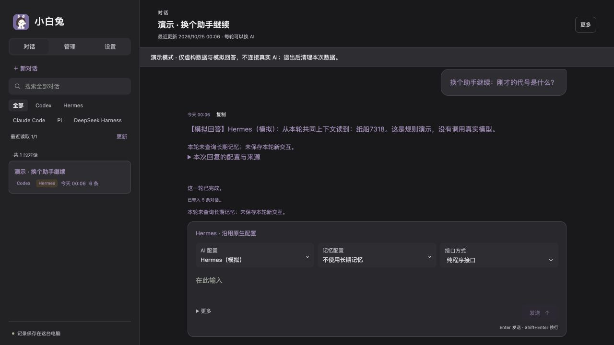

# White Rabbit · 小白兔

[English](README.md) · [简体中文](README.zh-CN.md)


**Keep conversations, materials, and work together as you move between AI agents.**

White Rabbit is a local workspace for people who use more than one AI assistant on a project. Find an earlier conversation, select the context and files you want to carry forward, and continue with a saved agent configuration. The aim is to spend less time finding materials and explaining the same project again.

This is an **early development release**, currently focused on macOS. The application interface is mainly in Chinese; the getting-started documentation is available in English and Chinese.



*The screenshot uses invented conversations. Demo replies are generated by local rules, not an AI model.*

## What is here

- **A conversation library:** browse and search indexed native histories, group related work, and keep Markdown references and snapshots.
- **Explicit context and materials:** preview selected messages and versioned text files before sending them to another agent. Image support depends on the configured agent and model.
- **Separate AI and memory profiles:** choose a saved agent/model configuration and a memory configuration independently.
- **Native agent connections:** experimental integrations for Codex, Hermes, Pi, Claude Code, and DeepSeek Harness, using their own execution and session mechanisms.
- **A management assistant:** a dedicated Codex conversation can use the same bounded application interfaces as the UI to inspect or change supported settings.
- **Reusable parts:** six Python packages separate content, input preparation, memory, native runtime foundations, UI resources, and the management assistant.

## Try the demo

You need **Python 3.11 or newer**. From a terminal:

```sh
git clone https://github.com/icecinz/white-rabbit.git
cd white-rabbit
python3 -B demo.py
```

Open <http://127.0.0.1:17862/>. No API key, model, or agent installation is needed for this demo. If the port is occupied, use `python3 -B demo.py --port 17863`.

Try this short path:

1. Search for `纸船` (paper boat) to find an invented earlier conversation containing `7318`.
2. Open the prepared conversation and ask `之前的代号是什么？` (What was the earlier code?).
3. Switch between the simulated Codex and Hermes profiles and ask again.
4. Use **更多 → 查看本轮上下文** (More → View context for this turn) to inspect what will be included.

The demo uses a temporary directory, invented history, and explicitly marked simulated replies. It does not read your native agent histories or call a model. Exit with **Ctrl+C** to remove the temporary demo data; it is not an everyday chat-storage mode.

## Use a real agent

Start with one agent you already have installed and configured. The [native-agent guide](docs/native-agents.md) covers startup commands, dependencies, and current limits. Native connections are disabled unless explicitly enabled with startup arguments.

Real mode differs from the demo: it can read local native histories, store application data, launch the selected agent, and use its existing account or API configuration. Online models receive the material sent to them. Agent programs, accounts, subscriptions, and optional services are not included in this repository.

## Current boundaries

- Development targets **macOS/POSIX**; Windows is not supported. Some file operations require macOS specifically.
- A handoff carries explicitly selected text and compatible materials. It does **not** transfer another agent's complete internal state.
- Native integrations are experimental. Tool coverage, permissions, recovery, images, and model compatibility vary by route; full feature parity and zero overhead are not claimed.
- Cross-computer task routing, remote wake-up, cloud backup, and automatic Markdown body synchronization are not implemented here. Mobile access currently relies on an external IM.codes connection to an online Mac.
- A request with an unknown outcome is checked through its existing receipt rather than automatically sent again.

## Build with us

Start with a small reproducible issue, a clearer interaction, or an adapter for an official agent interface. [Contributing](CONTRIBUTING.md) explains the workflow and how to report verification honestly.

[Architecture](ARCHITECTURE.md) · [Roadmap](ROADMAP.md) · [Native agents](docs/native-agents.md) · [Third-party notices](THIRD_PARTY_NOTICES.md)

White Rabbit's own code is released under the [MIT License](LICENSE). Bundled third-party components retain their own copyright and license notices.
