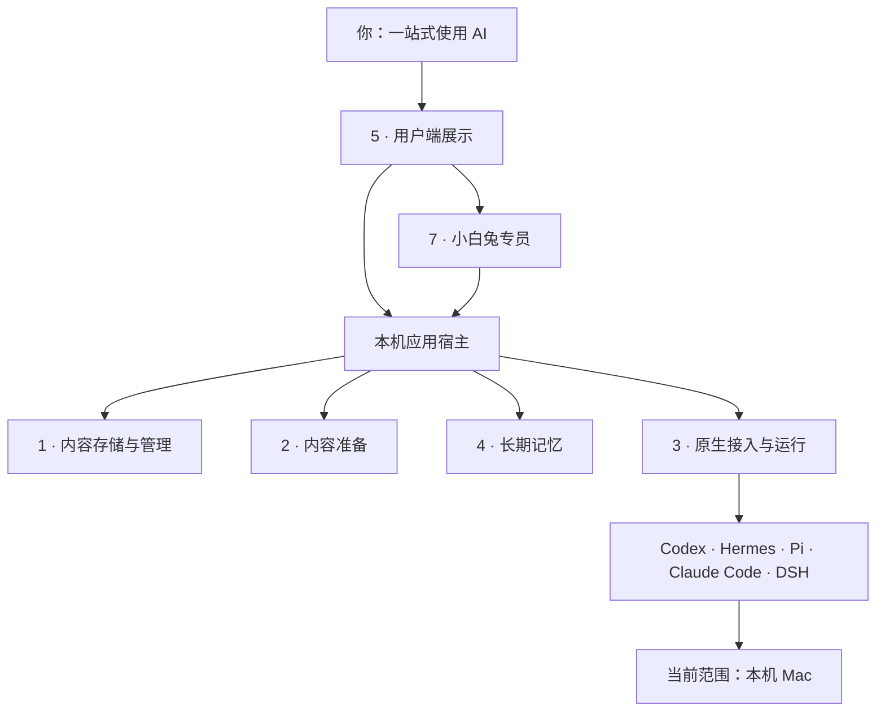

# White Rabbit · 小白兔

[English](README.md) · [简体中文](README.zh-CN.md)

[](https://github.com/icecinz/white-rabbit/actions/workflows/ci.yml)


**把常用的 AI 放在一起，接着做自己的事。**

小白兔想把所有 AI 放进一个入口。你可以在这里聊天，找回之前的工作，整理资料，也可以带着选好的材料换一个 AI 继续聊。

目前先支持一台 Mac，可连接 **Codex、Hermes、Pi、Claude Code 和 DeepSeek Harness（DSH）**。这些连接还在完善，各自沿用原来的模型、工具和审批规则。连接更多应用和设备是后续方向，跨设备控制尚未实现。

当前版本是 **0.2.0-alpha.2**，仍在早期开发。“我的 AI”现在可以查看常用 Agent、额度和用量。界面以中文为主，基础导航和设置标签可以切换英文。文档有中英文两版。

## 先装起来

**现在可以下载源码安装，还没有双击即装的安装包。** 需要一台 Mac、Python 3.11 或更新版本，以及一个已经配好、能正常使用的 AI 工具。不用把上面五个都装齐。

不懂编程也可以请能操作本机的 AI 帮忙安装。照着[新手安装说明](docs/getting-started.zh-CN.md)做，里面有可直接复制的话、下载方法和以后打开的步骤。只有网页聊天、不能读写本机文件和运行命令的 AI，无法代装。


*新版仪表盘演示。资源为虚构示例，账户和会话卡片的读数留空。*

## 可以用来做什么

- **看工具和用量。** 在“我的 AI”展开常用工具，可以进入对应的管理详情。找对话、接着聊都在左栏。
- **聊天和整理资料。** 搜索旧对话，按项目分组，把文件和 Markdown 整理文档放在一起。
- **换一个 AI 接着聊。** 在 Codex 与 Hermes 之间选择文字、完整文件和原图，先看草稿，按发送才新建对话。支持的只读原文页可以打开已有的接续结果，也可以回到同一段原文。
- **分别选 AI 和记忆。** AI 配置决定用哪个工具和模型，记忆配置决定额外带哪些长期资料。
- **让专员改设置。** 用一句话交代小白兔专员，不必逐个找开关。
- **拿走其中一块。** 开发者可以单独使用已拆出的模块，继续做自己的项目。

Codex 可以单独调整这段对话或未发送草稿的模型和强度。草稿细调建议要由原页面保存并返回回执，其他管理修改以相应接口结果和读回为准。Claude 可以选模型，强度沿用原生配置；DSH 暂不能在这里改模型，可以选下轮使用的只读记忆。详见[日常操作](docs/native-agents.zh-CN.md#日常操作)。

## 愿景与当前范围

| 功能 | 现在可以做什么 | 还要留意什么 |
| --- | --- | --- |
| AI 对话 | 连接上述五种 AI 工具 | 登录、模型、附件、工具和恢复能力要分别配置和检查 |
| 专员 | Codex、DSH 共用一段小白兔管理历史 | 各自保留原生会话；切换不搬走完整内部状态。DSH 专员共享记忆还没接通，Hermes 暂不能担任专员 |
| 找回工作 | 从左栏搜索，阅读已保存的文字，从原文打开已有的接续结果 | 读原文和恢复会话有各自的入口。外部桌面里正在运行的任务仍由原应用处理 |
| 额度和用量 | Codex、DeepSeek 看账户。Hermes、Pi、DeepSeek Harness 看会话 | 各来源保留自己的范围和读取时间。MiniMax 可选中国大陆或国际，按量余额和套餐额度使用各自的凭据 |
| 回到原应用 | 打开有链接的 Codex 原对话，或使用工具已有的入口。Hermes 和 DSH 可以打开本机网页 | 跳转依赖已安装的应用和本机环境。原应用入口用于导航 |
| HAPI 工作 | 手动发现工作，打开原会话网页 | 发送、审批和停止仍在 HAPI 完成 |
| 前文与记忆 | Codex／Hermes 材料接续，Hindsight 和独立 Hermes 文档记忆 | 不迁移完整会话状态；Mem0 要另配，尚不能自动保存 |
| AI 操作 | 通过已有接口改设置和管理资料 | 只有图形界面的应用代操作、AI／混合接口还没接通 |
| 使用设备 | 本机 Mac | 设备、唤醒、手机预览入口和 IM.codes 专用兼容已移出本版；历史手机访问见页末存档 |

**我的 AI**显示常用 Agent、额度与用量和简报，打开时先看已有记录。点**更新**才读取可用来源。更新失败时，同一连接的上次读数和时间仍保留。有本地简报时，可以在小白兔里看正文、日期和来源。

新对话和旧对话都从左栏打开，模型和记忆配置在管理页。点左上**首页**回仪表盘。左栏标签固定，各区分别记住滚动位置。还没接入时，点**查看 Agent 接入**。



*六个在用模块沿用原编号。原 6 号远程输入输出只保留历史说明。*

## 用专员减少设置按钮

**小白兔专员**负责管理小白兔。它先看当前情况，再通过已有接口改设置、找对话或整理资料，和界面使用同一套规则。

一些不常用的设置不再单独放开关，只显示当前值、可选值和说法示例。需要改时，直接告诉专员。登录、授权和原生审批仍由你处理。

可以这样说：

- “这段对话下一轮用项目记忆，保持只读。”
- “找到‘项目讨论’，先不要发送消息。”
- “把这份整理文档放进已有的‘工作’分组。”
- “把回答显示为原始文字，不做 Markdown 排版。”

在**设置 → 小白兔专员**里，可以选已接通的 Codex 或 DSH。同一段管理历史会保留，新核心接收尚未读到的对话文字，旧工具调用不会重新执行。

正在执行、等待审批、结果不明或内容超出容量时，不能切换。新连接失败会保留原核心、历史和草稿。结果不明时按原操作编号核对，不重复发送。


*早期设置页的实际运行截图，使用虚构资料。*

**核对并更新**会手动生成一份状态报告。程序先读取四项限定的配置信息，再让无工具的文字连接分析一次，保存来源和结果。它用已有的 Claude 配置，和所选专员核心分开；工具连接检查目前观察 Codex 一侧，不能据此判断全部 DSH 工具是否可用。刷新只读原报告，不会自动改设置或重做分析。详见[报告说明](docs/specialist.zh-CN.md#手动状态报告)和[专员介绍](docs/specialist.zh-CN.md)。

## 颜色说明谁能操作


| 颜色 | 含义 |
| --- | --- |
| **紫色** | 人可以阅读或操作，AI 也有对应的读取或操作接口。只读内容也可以是紫色。 |
| **黑色／中性色** | 目前需要人在界面上操作，或亲自确认。深色主题使用可读的中性色。 |

颜色用于整个条目，包括文字和控件。紫色只说明接口已经存在，具体操作仍要遵守权限，也不代表已经执行。详见[设计原则](docs/design.zh-CN.md)。

## 安装并使用真实 Agent

第一次使用，从[新手安装说明](docs/getting-started.zh-CN.md)开始。它面向使用者；[安装清单](docs/install-agent.zh-CN.md)给帮你安装的 AI 或熟悉命令行的人看。

安装后，在 Finder 按 **Command + Shift + G**，输入 `~/.imcodes/one-ai`，找到并双击 **打开小白兔.command**。也可以请安装助手把它的替身放在桌面。这个旧目录名不表示需要安装 IM.codes。

程序和数据保存在这个目录。请保留下载后选定的源码文件夹，供以后更新和查看文档。更新要保留原配置和聊天记录。常规安装目前支持 macOS；其他 POSIX 系统只有手动前台方式，Windows 暂不支持。

## 只看界面：虚构演示


*早期演示截图。回复由本地规则模拟。*

已有 Python 3.11 或更新版本的人，可以下载并解压源码，在项目文件夹打开终端运行：

```sh
python3 -B demo.py
```

然后打开 <http://127.0.0.1:17862/>。不需要 Key、模型或 Agent。端口被占用时，可用 `python3 -B demo.py --port 17863`。

试着搜索 `纸船`，打开准备好的对话，问“之前的代号是什么？”。切换模拟 Codex／Hermes 配置后再问一次，也可以从**更多 → 查看本轮上下文**查看带入的材料。

演示不读原生历史，数据放在临时目录。按 **Ctrl+C** 正常退出后清理，不能用来保存日常聊天。

## 把一块装进自己的项目

内容、准备、运行、记忆、界面和专员已拆成六个可安装模块，各有目录和 `pyproject.toml`。开发者可以只取需要的部分。

例如，在源码目录安装内容模块：

```sh
python3 -m pip install ./原型/rabbit_content
```

它提供文件快照、内容存储、发布回执和 Markdown 整理，不需要运行聊天服务器。各模块需要什么、还有哪些部分依赖小白兔宿主，见[模块与复用例子](ARCHITECTURE.md)。应用级专员协调器仍需宿主适配。

## 需要知道的边界

- 阅读历史、恢复会话、接管正在执行的任务，是三种不同能力。当前不能直接接管 Codex 桌面或 WorkBuddy 的进行中工作。
- 接续会带走选定的文字和兼容材料，不搬走另一家 AI 的完整内部状态。
- 真实模式会读取本机 Agent 资料，也可能启动 Agent。发给在线模型的材料会经所选服务传出本机；小白兔没有独立云备份。
- 发送结果不明时，保留原编号核对，不自动重发。符合条件的 Claude 最终回答可以本地保存；Pi／Hermes 在首次按原编号成功取回完整结果后保存。缺失或中断的结果不会补造。
- Windows、Markdown 正文自动同步、完整原生能力和性能等价，目前都不保证。

[模块结构](ARCHITECTURE.md) · [设计原则](docs/design.zh-CN.md) · [小白兔专员](docs/specialist.zh-CN.md) · [原生接入](docs/native-agents.zh-CN.md) · [近期路线](ROADMAP.md) · [更新记录](CHANGELOG.md) · [参与方式](CONTRIBUTING.md)

[手机访问实验的一段往事](docs/history/remote/README.zh-CN.md)

小白兔自有代码采用 [MIT 许可证](LICENSE)，随附部件保留原许可与署名，见[第三方声明](THIRD_PARTY_NOTICES.md)。
