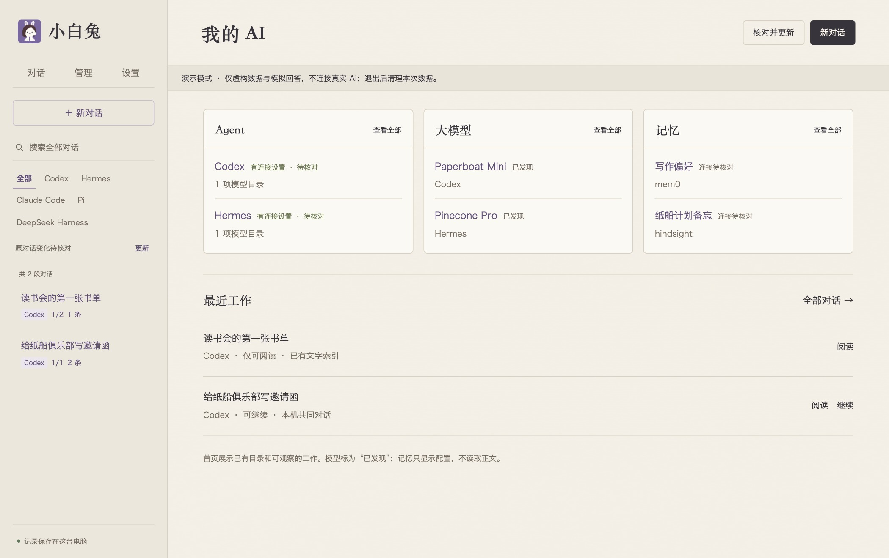
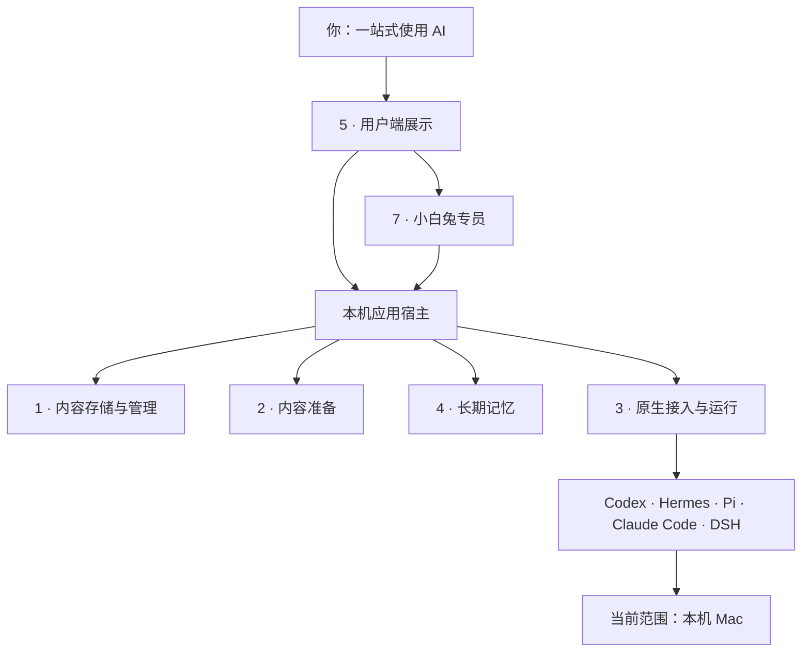
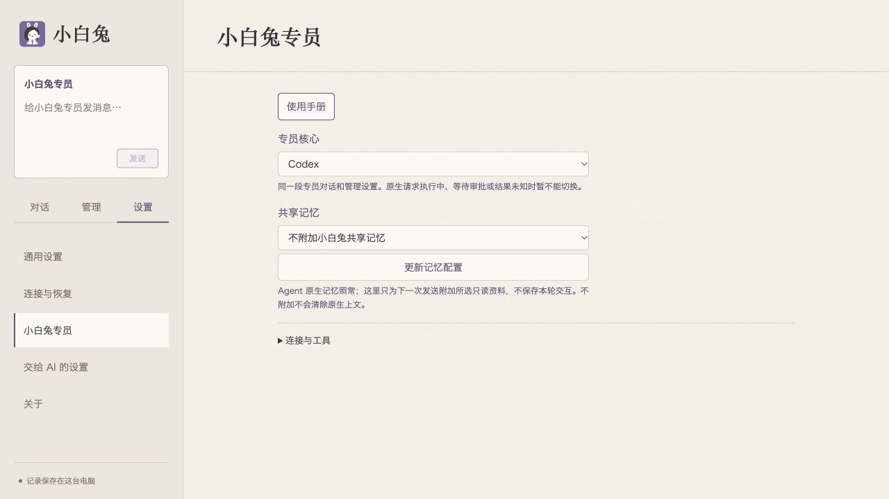
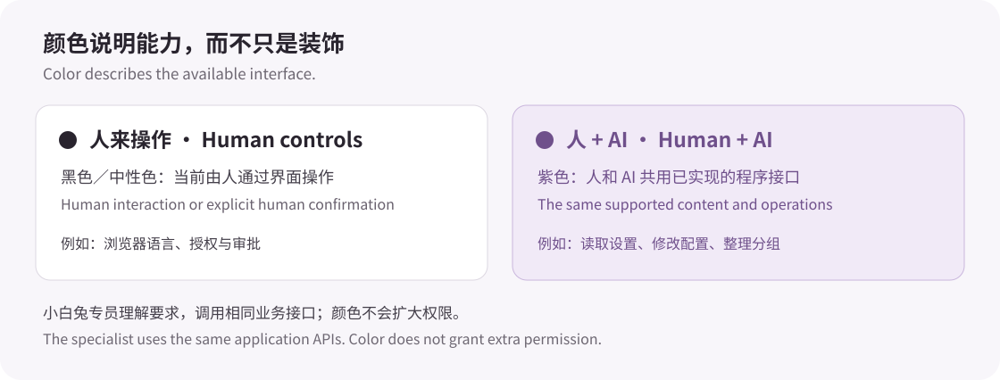
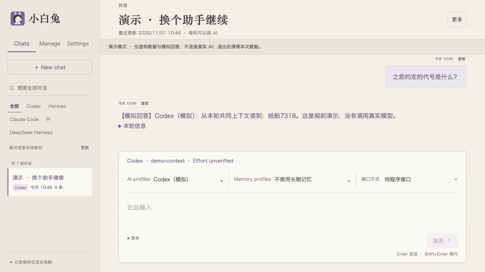

# White Rabbit · 小白兔

[English](README.md) · [简体中文](README.zh-CN.md)

[](https://github.com/icecinz/white-rabbit/actions/workflows/ci.yml)


**小白兔可以一站式地使用所有 AI。**

小白兔把 Agent、模型、对话、资料和记忆组织在一个本地入口。它先服务同时使用多个 AI 的个人：找到昨天的工作，选择接下来与谁合作，带上选好的材料，少找一次对话、少搬一次资料、少做一次重复配置。

“所有”是产品方向。当前在一台 Mac 上实验性接入 **Codex、Hermes、Pi、Claude Code 和 DeepSeek Harness（DSH）**。各家仍有自己的受支持模型、工具、会话和审批规则，不表示任意模型都能与任意 Agent 自由互换。

**0.2.0-alpha.1 · 应用蓝图 2.0 早期源码快照。** “我的 AI”汇集资源与最近工作，专员可以在同一应用历史中使用 Codex 或 DSH。连接条件与受支持操作仍按 Agent 分开；请配置自己原来就在用的 Agent，并在自己的环境核验真实回答与同会话续聊。

**早期开发版 · macOS／POSIX · Python 3.11+**。界面目前仍以中文为主，基础导航、管理和设置标签可切换英文；文档提供中英文两版。

**第一次安装：** 把[本项目链接](https://github.com/icecinz/white-rabbit)交给你的 Agent，让它按[安装清单](docs/install-agent.zh-CN.md)完成真实安装和对话验收。仓库根目录的 [AGENTS.md](AGENTS.md)也指向同一清单。下面的虚构演示仅用于看界面。



*实际运行界面，资源和工作是虚构示例，非设计效果图；请在自己的环境配置并验证。*

## 可以用来做什么

- **看清 AI 资源与最近工作：** “我的 AI”汇集 Agent、已发现模型、记忆配置与最近工作；进入同一资源的管理详情，继续受支持会话，或读取准确绑定的已存文字。
- **继续原生 Agent 的工作：** 实验性接入 Codex、Hermes、Pi、Claude Code、DeepSeek Harness，保留各自原生会话、工具和审批规则。
- **找回和整理项目资料：** 搜索已索引历史，为相关对话分组，把 Markdown 引用或快照与文件、成果放在一起。
- **在 Codex 与 Hermes 间接着聊：** 选择已读文字、完整登记文件和原图，按固定快照预览；先准备草稿，按发送才新建原生对话，并保留返回来源的入口。
- **分别选择 AI 和记忆：** 保存好的 AI 配置描述 Agent／模型组合，记忆配置独立决定额外带入的长期资料。
- **吩咐小白兔专员：** 启用一段管理对话，选择 Codex 或 DSH 作为核心，调用相同的受支持管理接口；普通 Agent 接入与能否担任专员分别记账。
- **单独复用部件：** 把独立打包的核心装进自己的 Python 项目，不必接入整个小白兔宿主。

各通路保留自己的发送、审批和恢复协议。Codex 可单独细调草稿／本对话的模型与强度；专员建议需原浏览器实际保存并返回回执，才算应用完成。Claude 可选择模型但不覆盖原生强度；DSH 模型修改暂留空，只读记忆仍可选择。[日常操作](docs/native-agents.zh-CN.md#日常操作)

## 愿景与当前范围

| 方面 | 当前已有实现 | 仍是目标或有限制 |
| --- | --- | --- |
| 普通 AI 对话 | Codex、Hermes、Pi、Claude Code、DSH 原生接入 | 登录、模型、工具、附件与恢复按 Agent 分别核验，不是全覆盖承诺 |
| 专员核心 | Codex／DSH 共用一段应用历史，各自保留原生会话，调用受支持管理接口 | 工具／模型可用性取决于原生配置；DSH 专员共享记忆未接通，Hermes 后置。换核不迁移完整原生内部状态 |
| 找到原有工作 | “我的 AI”资源摘要与同一条目导航；受支持的原生续聊和已存正文阅读 | 总览使用已存／缓存事实，可能仍待核对；外部桌面进行中任务尚未直接接管 |
| 在原应用打开 | 现有本机 Codex 链接指向准确的原线程 | 系统跳转与目标应用安装仍需按环境核验；其他 Agent 没有通用外开保证。打开原处是导航，不等于控制其活跃任务 |
| 外部工作发现 | 可选、手动的 HAPI Hub 工作发现，打开原会话页面 | 发送、审批、停止仍在 HAPI；发现工作不等于接管 |
| 前文与记忆 | Codex ↔ Hermes 选择材料接续；Hindsight 和独立 Hermes 文档记忆 | 接续不迁移 Agent 内部状态；Mem0 仍需配置，自动保存未接入 |
| 人与 AI 操作 | 共用应用接口、按版本改设置、独立专员 | 只有界面的应用代操作、AI／混合接口尚未接通 |
| 产品范围 | 本机 Mac；本源码快照已撤设备、唤醒、手机预览入口及 IM.codes 专用兼容 | 历史手机访问不等于跨设备 AI 控制，跨电脑接管与唤醒从未实现 |

打开**我的 AI**只读已有目录、索引与缓存执行事实，不启动 Agent、不发探测消息、不读记忆正文。已发现模型不等于模型实测可用，也不把无法观察的外部工作推断为空闲。从**新对话**开始；零接入时先**接入第一个 Agent**，点兔标返回总览。



*六个在用核心沿用原编号。原 6 号远程输入输出只作历史条目，没有另一个运行包。*

## 用专员减少设置按钮

**小白兔专员**调用与界面共用的应用接口来管理小白兔，数据和规则仍由各模块负责。一段连续的应用历史可以选择 **Codex 或 DSH** 执行，各自保留原生会话与已收到正文的位置；沿用原生登录与配置，不另建第二套设置系统。

在**设置 → 小白兔专员**中选核心。新核心接收尚未收到的对话正文，历史工具调用只作记录，不作为命令重放；成功后在同一历史写一处分界。执行中、待审批、结果未知或超容量时阻止切换，新核心连接失败就保留原核心、历史和草稿。切换或发送结果不确定时沿原操作编号核对，不靠重放命令查结果。



*实际运行界面，资源和工作是虚构示例，非设计效果图；请在自己的环境配置并验证。*

可以这样交代：

- “这段对话下一轮用项目记忆，保持只读。”
- “按名称找到‘项目讨论’，先不要发送消息。”
- “把这段对话的整理文档放进已有的‘工作’分组。”
- “把回答显示为原始文字，不做 Markdown 排版。”

一些低频设置只保留可读目录、当前值和说法示例，不再增加一排开关。需要修改时告诉专员：先读当前版本，再调用有限接口，并说明结果。登录、授权与原生审批仍由使用者处理。

**核对并更新**是一份独立的手动报告：程序先读取限定范围的四项元数据，可用的无工具文字连接只分析一次冻结证据，应用再带来源保存报告。刷新读取已有报告，不重新分析；缺失或变化的依据继续标明。报告分析走已有的 Claude 配置文字适配器，与所选管理核心分开。当前专员工具事实观察 Codex 一侧的连接，不据此证明全部 DSH 工具可用；检查不自动改设置，也不代表每个模型／工具都已实测。[报告怎样生成](docs/specialist.zh-CN.md#手动状态报告)

[认识小白兔专员](docs/specialist.zh-CN.md)

## 颜色说明谁能操作



| 外观 | 含义 |
| --- | --- |
| **紫色** | 人可以阅读或使用，AI 也有受支持的程序通路读取同一内容或完成对应操作；只读内容同样可以是紫色。 |
| **黑色／中性色** | 当前由人通过界面完成，或仍需人亲自确认；深色主题使用可读的中性色。 |

颜色描述已有接口，不额外授予权限，也不证明操作已经执行。它作用于完整条目，不只给按钮着色。[设计原则](docs/design.zh-CN.md)

## 安装并使用真实 Agent

可以直接对你的 Codex、Hermes 或 DSH 说：

> 帮我安装 https://github.com/icecinz/white-rabbit ，按仓库 AGENTS.md 和安装清单操作。先接通一个我已经在使用的 Agent，保留原模型、提供商和登录配置；用真实对话、刷新后续聊验收，最后告诉我以后怎么打开。

安装 Agent 应先检查 macOS、Python 3.11+、已有安装和所选 Agent 的依赖，写入只含本机路径的连接配置，再运行随包安装器。不要把 `demo.py` 或未启用原生连接的空页面当成安装完成。按[安装清单](docs/install-agent.zh-CN.md)找到稳定的 Python 3.11+ 绝对路径；下例中的路径需要替换。

```sh
git clone https://github.com/icecinz/white-rabbit.git
cd white-rabbit
RABBIT_PYTHON="/absolute/path/to/python3.11"
"$RABBIT_PYTHON" --version
"$RABBIT_PYTHON" -B 原型/install_local.py check --source-dir "$PWD/原型"
```

首次检查提示需要连接配置是正常的。按[安装清单](docs/install-agent.zh-CN.md)和[连接配置示例](docs/native-agents.zh-CN.md)配置一个 Agent，然后检查、安装、打开。安装器复用现有本机方案：登录启动、私有运行副本、持久数据及打开入口。**专员和额外记忆服务可稍后配置。**

下次可双击 `~/.imcodes/one-ai/打开小白兔.command`，无需设置变量。也可用安装时选定的 Python 绝对路径运行（替换示例路径）：

```sh
"/absolute/path/to/python3.11" -B "$HOME/.imcodes/one-ai/manage.py" open
```

数据保存在 `~/.imcodes/one-ai`；这个旧目录名不表示需要安装 IM.codes。更新时保留已有配置和记录，端口冲突时先核对已有服务。当前持久安装支持 macOS；其他 POSIX 系统只有手动前台路径，Windows 尚未支持。

## 只看界面：虚构演示



*独立的规则模拟预览，不调用真实 Agent。*

```sh
git clone https://github.com/icecinz/white-rabbit.git
cd white-rabbit
python3 -B demo.py
```

准备 **Python 3.11+**，打开 <http://127.0.0.1:17862/>。无需 Key、模型或 Agent。如果端口被使用，可改为 `python3 -B demo.py --port 17863`。

1. 搜索 `纸船`，找到包含虚构编号 `7318` 的旧对话。
2. 打开准备好的聊天，问“之前的代号是什么？”。
3. 切换模拟 Codex／Hermes 配置，再问一次，并从**更多 → 查看本轮上下文**检查带入内容。

演示不读原生历史、不调用模型，使用临时目录；按 **Ctrl+C** 正常退出后清理。需要长期保存并使用已安装 Agent 时，按[真实接入指南](docs/native-agents.zh-CN.md)启动。

## 把一块装进自己的项目

项目有**六个已经拆出的可安装核心**：内容、准备、运行、记忆、界面和专员，各有目录及 `pyproject.toml`；还留在宿主的装配部分会明确说明。继续沿用原编号，远程输入输出只作历史 6 号，而不是另一个可安装包。新增应用级专员协调器仍需要宿主适配，可独立复用的接口与宿主集成分别列明。

例如，只从当前源码安装内容核心：

```sh
python3 -m pip install ./原型/rabbit_content
```

它提供文件快照、内容存储、发布回执和 Markdown 整理，不需要运行聊天服务器。[模块与复用例子](ARCHITECTURE.md)说明各包依赖、公开接口和宿主需要提供什么。

## 需要知道的边界

- 读取历史、恢复保存的会话、控制外部存活任务是不同能力。CLI 能工作，不代表原桌面应用已经被接管。
- 交接的是选定文字与兼容材料，不迁移另一家 Agent 的完整内部状态。模型组合、图片、恢复和工具需要分别核验。
- 真实模式会读取本机 Agent 来源，也可以启动 Agent。在线模型会通过所选服务接收发送的资料；当前没有独立云备份。
- 发送结果未知时保留原编号并核对，不自动重发。符合条件的 Claude 最终回答可在本机保存；Pi／Hermes 的完整结果在首次按原编号成功读回后保存。缺失或中断的结果不补造。
- Windows、Markdown 正文自动同步，以及完整原生能力／性能等价，不是当前版本承诺。

[模块结构](ARCHITECTURE.md) · [设计原则](docs/design.zh-CN.md) · [小白兔专员](docs/specialist.zh-CN.md) · [原生接入](docs/native-agents.zh-CN.md) · [近期路线](ROADMAP.md) · [更新记录](CHANGELOG.md) · [参与方式](CONTRIBUTING.md)

[手机访问实验的一段往事](docs/history/remote/README.zh-CN.md)

小白兔自有代码采用 [MIT 许可证](LICENSE)，随附部件保留原许可与署名，见[第三方声明](THIRD_PARTY_NOTICES.md)。
