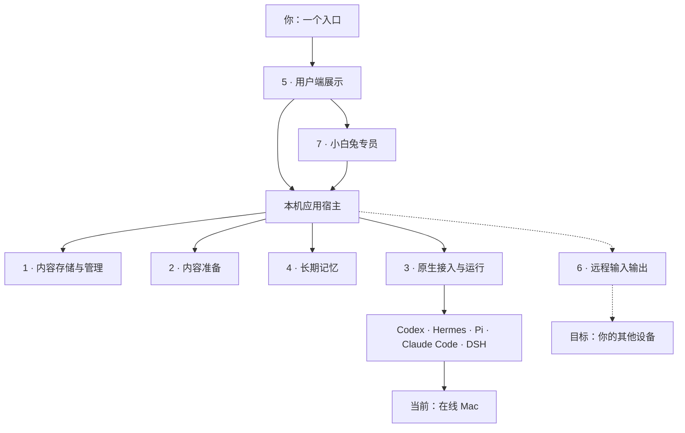
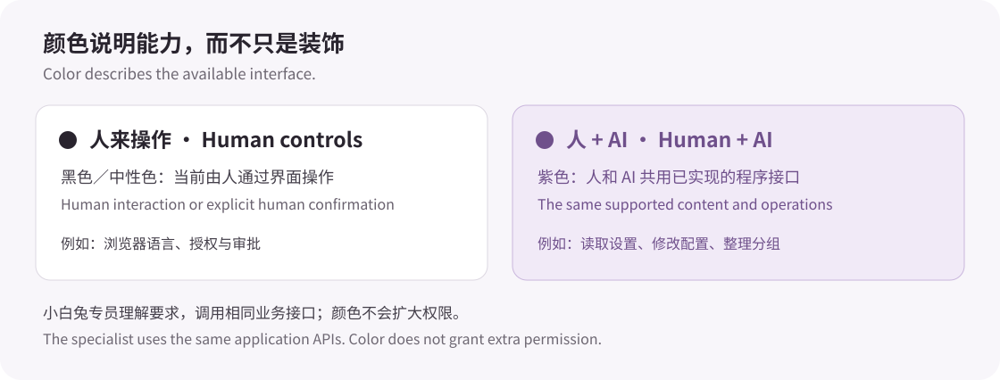

# White Rabbit · 小白兔

[English](README.md) · [简体中文](README.zh-CN.md)

[](https://github.com/icecinz/white-rabbit/actions/workflows/ci.yml)


**所有 AI 工作的一个入口，逐步连接工作所在的设备。**

小白兔把原生 Agent 的工作、对话、资料和记忆组织在一个本地入口。按任务选择 Agent 和模型，继续受支持的会话、查看进度，并把工作整理在一起，减少每次从头找资料、解释项目的麻烦。

长期目标是从同一个地方联系不同 AI，连接它们工作的各台设备。当前先做好**一台在线 Mac**，主要管理小白兔自己持有的原生连接；直接连接外部桌面应用里正在进行的工作，仍是需要补齐的部分。

**早期开发版 · macOS／POSIX · Python 3.11+**。界面目前仍以中文为主，基础导航、管理和设置标签可切换英文；文档提供中英文两版。


*截图使用虚构对话和明确标记的本地规则回复，不能用来判断真实模型效果。*

## 可以用来做什么

- **继续原生 Agent 的工作：**实验性接入 Codex、Hermes、Pi、Claude Code、DeepSeek Harness，保留各自原生会话、工具和审批规则。
- **找回和整理项目资料：**搜索已索引历史，为相关对话分组，把 Markdown 引用或快照与文件、成果放在一起。
- **明确带上所需前文：**先预览消息和固定版本的文件，再交给另一个 Agent；原图能力按具体通路和模型开放。
- **分别选择 AI 和记忆：**保存好的 AI 配置描述 Agent／模型组合，记忆配置独立决定额外带入的长期资料。
- **吩咐小白兔专员：**通过固定管理对话调整已接通设置、整理工作，或向已有原生对话交办任务。
- **单独复用部件：**把独立打包的核心装进自己的 Python 项目，不必接入整个小白兔宿主。

## 愿景与当前范围

| 方面 | 当前已有实现 | 仍是目标或有限制 |
| --- | --- | --- |
| AI 工作的统一入口 | 五种原生 Agent 通路；查看小白兔已持有工作的状态并回到原会话 | Codex 桌面、WorkBuddy 进行中任务尚未直接接通 |
| 外部工作发现 | 可选、手动的 HAPI Hub 工作发现，打开原会话页面 | 发送、审批、停止仍在 HAPI；发现工作不等于接管 |
| 前文与记忆 | 明确选择材料；Hindsight 和独立 Hermes 文档记忆 | Mem0 是待配置的可选只读桥，自动保存尚未接入 |
| 人与 AI 操作 | 共用应用接口、按版本改设置、独立专员 | 只有界面的应用代操作、AI／混合接口尚未接通 |
| 设备 | 本机 Mac；通过另行配置的 IM.codes 从手机访问 | 跨电脑调度、设备管理与远程唤醒仍待实现 |



*虚线表示更完整的设备连接目标。现有手机通路通过 IM.codes 打开同一台 Mac 上的服务。*

## 用专员减少设置按钮

**小白兔专员**拥有一段固定的原生 Codex 对话，调用与界面共用的应用接口。数据和规则仍由各模块负责，专员不另建第二套设置系统。

可以这样交代：

- “这段对话下一轮用项目记忆，保持只读。”
- “按名称找到‘项目讨论’，先不要发送消息。”
- “把这段对话的整理文档放进已有的‘工作’分组。”
- “把回答显示为原始文字，不做 Markdown 排版。”

一些低频设置只保留可读目录、当前值和说法示例，不再增加一排开关。需要修改时告诉专员：先读当前版本，再调用有限接口，并说明结果。登录、授权与原生审批仍由使用者处理。

[认识小白兔专员](docs/specialist.zh-CN.md)

## 颜色说明谁能操作



| 外观 | 含义 |
| --- | --- |
| **紫色** | 人可以阅读或使用，AI 也有受支持的程序通路读取同一内容或完成对应操作；只读内容同样可以是紫色。 |
| **黑色／中性色** | 当前由人通过界面完成，或仍需人亲自确认；深色主题使用可读的中性色。 |

颜色描述已有接口，不额外授予权限，也不证明操作已经执行。它作用于完整条目，不只给按钮着色。[设计原则](docs/design.zh-CN.md)

## 先试虚构演示

```sh
git clone https://github.com/icecinz/white-rabbit.git
cd white-rabbit
python3 -B demo.py
```

准备 **Python 3.11+**，打开 <http://127.0.0.1:17862/>。无需 Key、模型或 Agent。如果端口被使用，可改为 `python3 -B demo.py --port 17863`。

1. 搜索 `纸船`，找到包含虚构编号 `7318` 的旧对话。
2. 打开准备好的聊天，问“之前的代号是什么？”。
3. 切换模拟 Codex／Hermes 配置，再问一次，并从**更多 → 查看本轮上下文**检查带入内容。

演示不读原生历史、不调用模型，使用临时目录；按 **Ctrl+C** 正常退出后清理。需要长期保存并使用已安装 Agent 时，按[真实接入指南](docs/native-agents.zh-CN.md)启动。

## 把一块装进自己的项目

项目有**七项职责、六个已经拆出的可安装核心**。内容、准备、运行、记忆、界面和专员各有目录及 `pyproject.toml`；还留在宿主的装配部分会明确说明。远程输入输出还没有独立的第七个包。

例如，只从当前源码安装内容核心：

```sh
python3 -m pip install ./原型/rabbit_content
```

它提供文件快照、内容存储、发布回执和 Markdown 整理，不需要运行聊天服务器。[模块与复用例子](ARCHITECTURE.md)说明各包依赖、公开接口和宿主需要提供什么。

## 需要知道的边界

- 读取历史、恢复保存的会话、控制外部存活任务是不同能力。CLI 能工作，不代表原桌面应用已经被接管。
- 交接的是选定文字与兼容材料，不迁移另一家 Agent 的完整内部状态。模型组合、图片、恢复和工具需要分别核验。
- 真实模式会读取本机 Agent 来源，也可以启动 Agent。在线模型会通过所选服务接收发送的资料；当前没有独立云备份。
- 发送结果未知时保留原编号并核对，不自动重发。结果保存因通路而异：Pi／Hermes 使用当前连接缓存，符合条件的 Claude 最终回答可保存在有界的本机回执中。
- Windows、Markdown 正文自动同步，以及完整原生能力／性能等价，不是当前版本承诺。

[模块结构](ARCHITECTURE.md) · [设计原则](docs/design.zh-CN.md) · [小白兔专员](docs/specialist.zh-CN.md) · [原生接入](docs/native-agents.zh-CN.md) · [近期路线](ROADMAP.md) · [更新记录](CHANGELOG.md) · [参与方式](CONTRIBUTING.md)

小白兔自有代码采用 [MIT 许可证](LICENSE)，随附部件保留原许可与署名，见[第三方声明](THIRD_PARTY_NOTICES.md)。
