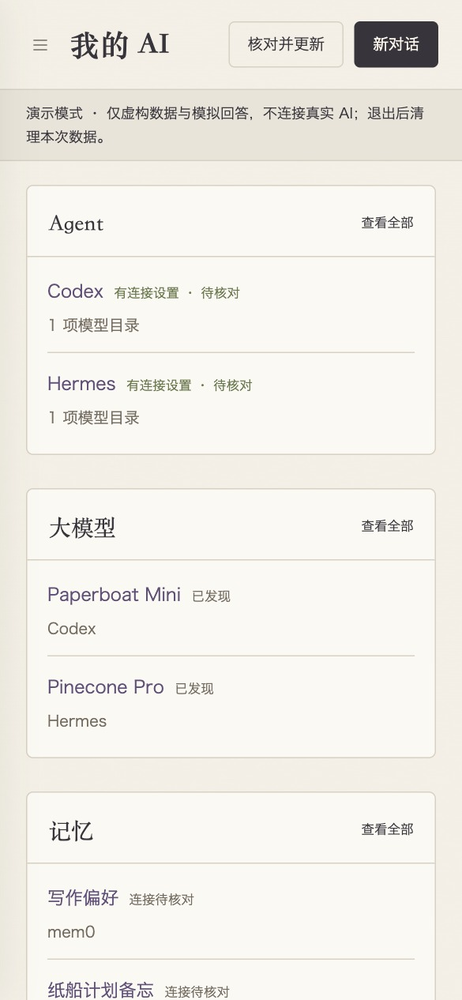
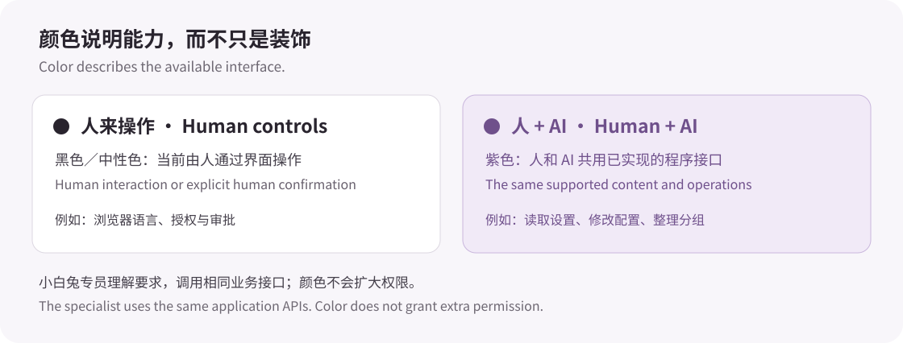
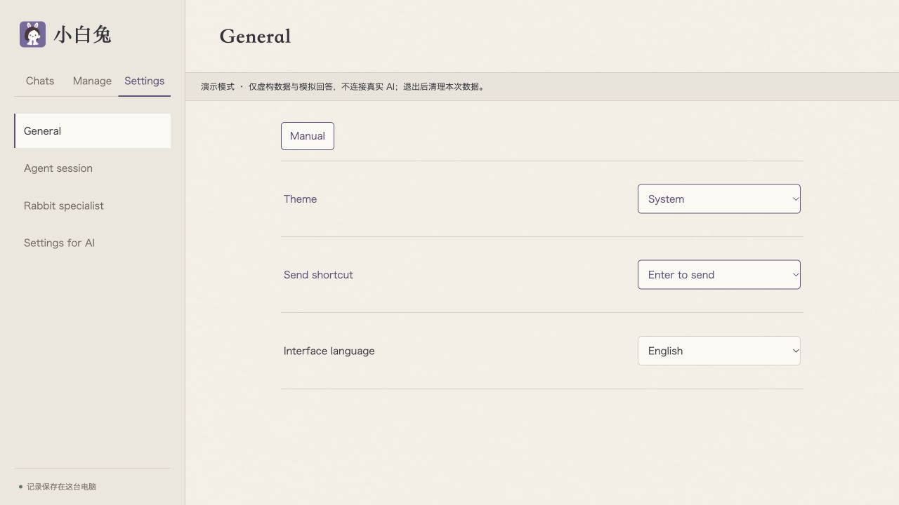
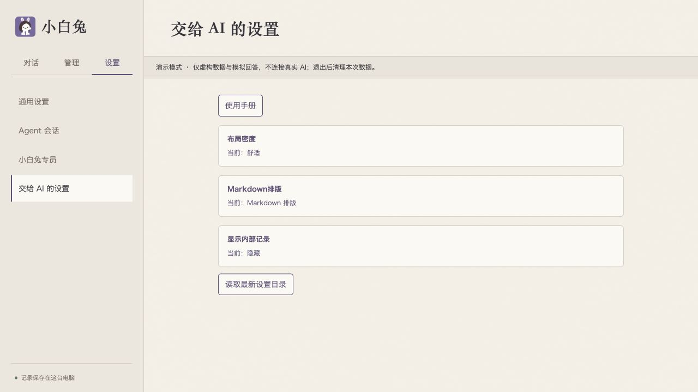

# Design principles

[English](design.md) · [简体中文](design.zh-CN.md) · [Home](../README.md)

White Rabbit aims to make several agents feel reachable from one place while keeping their identities, data, and capabilities understandable. Three requirements shape the design: preserve native work, let AI handle supported management, and make the parts independently reusable.

The 0.2.0-alpha.1 early source snapshot implements the following paths. Native connection requirements and capabilities remain explicit rather than inferred from the page layout.

## Four places, one application

| Place | Purpose | Action boundary |
| --- | --- | --- |
| My AI | Summarize agents, discovered models, memory profiles, and recent work | Enter the same resource's management detail or the exact work item; New conversation opens the composer, and the rabbit icon returns here |
| Conversations | Start, search, read, or continue work | Sending starts work; choosing a configuration stays on the same page, and refresh retains the page and browser-local draft |
| Management and settings | Inspect resource details and maintain supported configuration | Sources and observation times belong in details; zero connections has a Connect your first agent action |
| Rabbit specialist | Give management instructions without leaving the current work | The upper-left input stays available; its title opens the continuous history and guide |

Opening or polling **My AI** reads saved directories, indexes, and cached execution facts. It does not start an agent, probe a model, or read memory content. Discovered models stay labeled as discovered; stale or unknown execution observations are not upgraded to running or idle. Only an explicit **Check and update** begins the separate report pipeline.

*Running application with invented resources and work, not a design mockup. Configure and verify it in your own environment.*

The specialist's **core selector** belongs in settings and currently uses the human-facing neutral style. Codex and DSH retain separate native sessions behind one application history. Only a successful switch adds one boundary; missing prose is supplied on the next turn, while historical tool calls are never replayed. The shared interface does not make every tool, approval, or recovery path interchangeable.

## Warm paper, ink purple, moss green

The current visual layer uses a warm paper background, clean panels, ink purple, and restrained moss-green accents. Headings use a system Song/serif face; body text and controls use a system sans-serif, while code stays monospaced. Fine borders, small corners, little shadow, and a bundled static paper texture keep the content readable. Dark mode uses a separate warm-gray/soft-purple palette.

Theme tokens live in `原型/rabbit_ui/assets/soft_paper.css`. This style layer leaves the navigation, composing logic, and existing purple/neutral capability boundaries intact; green accents do not grant an AI operation or imply a healthy state.

## One entry, native work

An agent is the program that executes a task; a model is one of the services it calls. An AI profile saves a supported combination, while a memory profile independently chooses extra long-term material. These are separate choices, not a promise that every model works with every agent.

The entry should help people find the work already in progress, inspect its status, and continue the same native session where supported. History reading, saved-session recovery, and controlling a live external executor are tracked separately. The current host primarily controls its own connections; external desktop-work attachment remains incomplete.

The source snapshot removes device categories, wake-up placeholders, phone-preview entries, and IM.codes-specific compatibility. It keeps the local web service, access checks, local record identity, and browser drafts; separately installed user software is untouched. Historical phone access and the unfinished cross-device idea are documented separately. **About → A letter from White Rabbit** reads one bundled text; the public history export uses that same source, rather than a second editable letter.

Codex, Hermes, Pi, Claude Code, and DSH retain one basic composing path from the new-conversation draft through native continuation, while preserving their own sending, approval, and recovery protocols. Codex ↔ Hermes handoff uses selected, fixed text/file/image snapshots, prepares without executing, and creates the target only on Send. Specialist suggestions for Codex draft tuning wait for the originating page's versioned save receipt before claiming application. Other management changes use the corresponding interface result and readback. Conversation identity, native protocol, and supported material still belong to the selected agent.

An unavailable native conversation can still open its exactly bound saved text in the same entry. This read-only path supports paging, refresh, source selection, and return while preserving the original draft. Hermes source segments remain separate, and source changes require an explicit reread. Reading stored text does not start, restore, or take over an agent; live text without a reliable message mapping retains the search excerpt only.

Original-application navigation is another separate action. Local Codex can provide its exact thread link, with the installed target and system handoff verified per environment. Other agents have no universal external-opening guarantee. A link to the right place does not grant control of a task already running there.

## Fewer controls, a readable settings catalog

Frequently used actions stay visible: composing, sending, choosing saved profiles, and common appearance preferences. Less frequent operations move into a clearly scoped menu or a readable settings catalog when a reliable program interface exists.

For example, Markdown display and internal-record visibility are described with their current values and supported alternatives under **Settings for AI**. They do not each need a separate switch. A person can read the explanation and ask the specialist to make the supported change.

This is not an arbitrary configuration editor. The specialist reads the current schema/version, submits only supported fields, and rereads after a conflict. The catalog and interface come from shared definitions; a prose instruction alone does not create an operation.

## Evidence and placement are separate

| Dimension | Categories | What it tells the reader |
| --- | --- | --- |
| Evidence / interpretation | Program fact · AI judgment · AI explanation | What was actually observed, what the AI concludes from that evidence, and how it explains the conclusion |
| Presentation scope | Current operation · Overview · Card · Detail | Where and at what level the same information is presented |

An AI explanation in an overview is still an explanation, not a new program fact. Purple/neutral describes the access path, not which conclusion is true. The manual [status report](specialist.md#manual-status-report) follows program facts → one tool-free analysis → a saved, source-labeled report. Refresh reuses that report and can flag changed evidence; it does not automatically repair settings or repeat analysis.

Configuration wording follows the same rule: **Start a new profile from this profile** describes a new saved configuration, not a copied native session. The former default-for-new-chats action has been removed from the page; the composer remains the explicit place to select a saved profile.

## Purple and neutral are interface information

| Entry | Human path | AI path |
| --- | --- | --- |
| Purple | Read it or use the action it exposes | Read the same content or perform the supported action through an implemented API/protocol/tool |
| Black / neutral | Use the current interface or handle a personal confirmation | A direct program route is not currently exposed, or the step still needs a person |
| Purple settings document | Read the allowed values and ask for a change | Use the documented bounded operation; no individual graphical switch is required |

The whole entry inherits its meaning: title, description, current value, readable body, and applicable controls. It is not a decoration added to individual buttons. In dark mode the human-facing color is a legible neutral rather than literal black.

Purple includes read-only program access. It does not mean every field is writable, the action has succeeded, or permission has been granted. Login, authorization, and native approvals keep their own human confirmation path.

*The theme uses a shared programmatic interface. The interface-language selection belongs to this browser and retains a human-facing neutral appearance. The screenshot uses the fictional demo.*

*Infrequent supported settings remain readable, with values and examples; the specialist applies changes through the same settings contract.*

## Direct connections and application operation

A mature CLI, SDK, or protocol is the preferred connection. The intended fallback is for the specialist to organize a narrow task in the original application using supported interface tools, preserving the original session and result source.

Only the **direct program interface** is currently usable. AI-interface and mixed-interface choices remain marked as unconnected. A visible tool directory, installed application, or desktop experiment is insufficient to call that fallback operational.

## Clean structure is part of the result

Each core should have its own package, inputs, outputs, and failure behavior. Identity, capability, execution, and display should be separable; replacing a piece should cause as little change elsewhere as possible. Shared data keeps one owner, and necessary transactions stay together.

Six cores have been extracted, with some host assembly remaining. Reuse those interfaces before introducing a new service, agent loop, settings store, or generalized orchestration framework. See [architecture and reuse](../ARCHITECTURE.md) and the [specialist guide](specialist.md).
