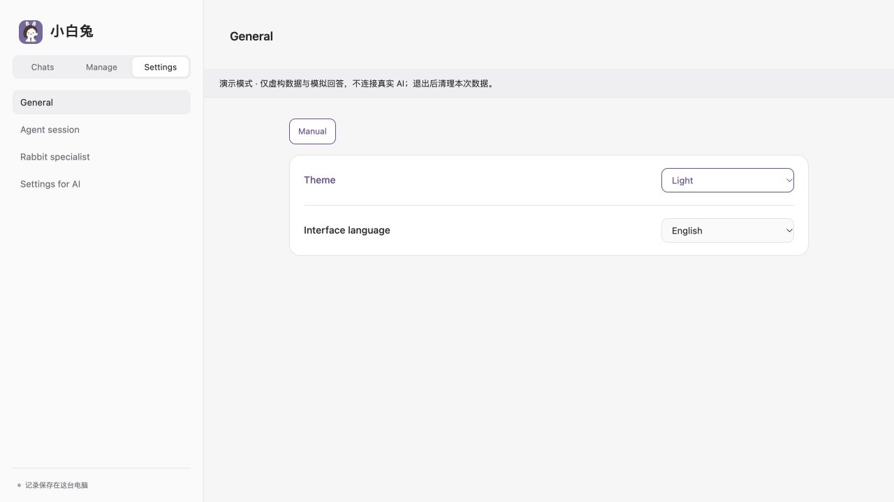

# Design principles

[English](design.md) · [简体中文](design.zh-CN.md) · [Home](../README.md)

White Rabbit aims to make several agents feel reachable from one place while keeping their identities, data, and capabilities understandable. Three requirements shape the design: preserve native work, let AI handle supported management, and make the parts independently reusable.

## One entry, native work

An agent is the program that executes a task; a model is one of the services it calls. An AI profile saves a supported combination, while a memory profile independently chooses extra long-term material. These are separate choices, not a promise that every model works with every agent.

The entry should help people find the work already in progress, inspect its status, and continue the same native session where supported. History reading, saved-session recovery, and controlling a live external executor are tracked separately. The current host primarily controls its own connections; external desktop-work attachment remains incomplete.

The device goal extends that entry to the places where work happens. Current phone access opens the same online Mac through IM.codes. Cross-computer task routing and wake-up remain later work, not hidden capabilities of the current UI.

## Fewer controls, a readable settings catalog

Frequently used actions stay visible: composing, sending, choosing saved profiles, and common appearance preferences. Less frequent operations move into a clearly scoped menu or a readable settings catalog when a reliable program interface exists.

For example, Markdown display and internal-record visibility are described with their current values and supported alternatives under **Settings for AI**. They do not each need a separate switch. A person can read the explanation and ask the specialist to make the supported change.

This is not an arbitrary configuration editor. The specialist reads the current schema/version, submits only supported fields, and rereads after a conflict. The catalog and interface come from shared definitions; a prose instruction alone does not create an operation.

## Purple and neutral are interface information

| Entry | Human path | AI path |
| --- | --- | --- |
| Purple | Read it or use the action it exposes | Read the same content or perform the supported action through an implemented API/protocol/tool |
| Black / neutral | Use the current interface or handle a personal confirmation | A direct program route is not currently exposed, or the step still needs a person |
| Purple settings document | Read the allowed values and ask for a change | Use the documented bounded operation; no individual graphical switch is required |

The whole entry inherits its meaning: title, description, current value, readable body, and applicable controls. It is not a decoration added to individual buttons. In dark mode the human-facing color is a legible neutral rather than literal black.

Purple includes read-only program access. It does not mean every field is writable, the action has succeeded, or permission has been granted. Login, authorization, and native approvals keep their own human confirmation path.

*The theme uses a shared programmatic interface. The interface-language selection belongs to this browser and retains a human-facing neutral appearance. The screenshot uses the fictional demo.*

*Infrequent supported settings remain readable, with values and examples; the specialist applies changes through the same settings contract.*

## Direct connections and application operation

A mature CLI, SDK, or protocol is the preferred connection. The intended fallback is for the specialist to organize a narrow task in the original application using supported interface tools, preserving the original session and result source.

Only the **direct program interface** is currently usable. AI-interface and mixed-interface choices remain marked as unconnected. A visible tool directory, installed application, or desktop experiment is insufficient to call that fallback operational.

## Clean structure is part of the result

Each core should have its own package, inputs, outputs, and failure behavior. Identity, capability, execution, and display should be separable; replacing a piece should cause as little change elsewhere as possible. Shared data keeps one owner, and necessary transactions stay together.

Six cores have been extracted, with some host assembly remaining. Reuse those interfaces before introducing a new service, agent loop, settings store, or generalized orchestration framework. See [architecture and reuse](../ARCHITECTURE.md) and the [specialist guide](specialist.md).
