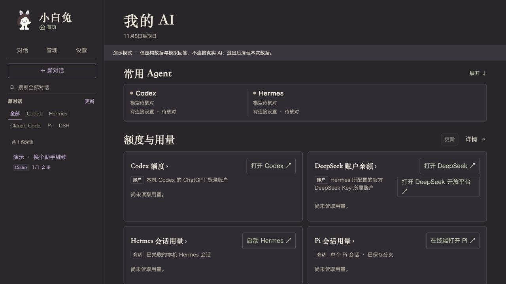

# 设计原则

[English](design.md) · [简体中文](design.zh-CN.md) · [首页](../README.zh-CN.md)

小白兔希望让你从一个地方使用不同 Agent，同时分清它们的身份、数据和能力。设计有三个要求：保留 Agent 原来的工作，让 AI 处理已经接通的管理操作，各个部件也能单独使用。

0.2.0-alpha.2 早期源码快照已实现下面的流程。每种原生连接需要什么、能做什么，会分别写清，不能看到页面就以为已经接通。

## 四个去处，一套应用

| 去处 | 做什么 | 操作边界 |
| --- | --- | --- |
| 我的 AI | 查看常用 Agent、额度与用量，阅读本地简报 | 展开 Agent 可进入详情。点击“更新”才读取用量。左栏“首页”回到仪表盘 |
| 对话 | 开始、搜索、阅读或继续工作 | 按发送才开始。选配置不换页，刷新保留当前页面和这个浏览器里的草稿 |
| 管理与设置 | 看资源详情，修改支持的配置 | 来源与核对时间放在详情里。还没接入时，提供“接入第一个 Agent” |
| 小白兔专员 | 留在当前页面交代管理任务 | 左上一直有输入框，点标题才打开同一份对话历史与指南 |

**我的 AI**打开或定时更新时，只读已有目录、索引和缓存的运行记录。它不启动 Agent，也不探测模型或读取记忆正文。目录里找到的模型仍标“已发现”。运行记录已经过时或情况不明，就不能标成进行中或空闲。明确点**核对并更新**才开始生成另一份报告。

*新版实际运行界面。演示使用虚构对话，额度和用量卡片为空。*

专员**核心选择**放在设置中，用表示人操作的中性色。Codex 与 DSH 在同一份应用历史中，各自保留原生会话。切换成功后才加一处分界，下一轮再把缺少的正文交给新核心，不重新执行以前的工具调用。共用接口不表示所有工具、审批和恢复方式都能互换。

## 暖纸、墨紫与苔绿

界面采用暖纸底和干净的面板，主色是墨紫，辅以少量苔绿。标题用系统宋体，正文与控件用系统黑体，代码保持等宽。边框细、圆角小，阴影也少。纸纹是随包提供的静态图片。深色主题另配暖灰和柔紫，保持正文清楚可读。

主题样式放在 `原型/rabbit_ui/assets/soft_paper.css`，不另写导航或输入逻辑，也不改变已有紫色／中性色的含义。苔绿只是辅助标记，不代表 AI 能操作，也不代表状态正常。

## 一个入口，继续原来的工作

Agent 是执行任务的程序，大模型是它调用的服务。AI 配置保存两者支持的组合，记忆配置另外决定带入哪些长期资料。这几个选项分开保存，不表示任意模型都能搭配任意 Agent。

小白兔应帮助你找到手头的工作、查看状态，并在支持时继续同一原生会话。查看历史、恢复已保存的会话、控制外部正在运行的任务，是三种能力，要分别说明。小白兔主程序目前主要管理自己建立的连接，还不能直接接上外部桌面任务。

本源码快照已撤下设备分类、唤醒占位、手机预览入口和 IM.codes 专用兼容。仍保留本机网页服务和访问校验，local 记录身份与浏览器草稿也不变，不处理用户另外安装的软件。以前的手机访问成果和未完成的跨设备设想单独存档。**关于 → 一封旧信**读取随包正文，公开历史也从同一来源导出，不另外维护一份旧信。

Codex、Hermes、Pi、Claude Code、DSH 从新对话草稿到继续原生对话，使用同一套基本输入区，但各自保留发送、审批和恢复协议。Codex ↔ Hermes 接续只带你明确选择的文字、文件和原图，使用固定版本快照。准备时不执行任务，按发送才新建目标对话。Codex 局部细调中的草稿建议，要等原页面按版本保存并返回回执，才算应用成功。其他管理修改以相应接口结果和读回为准。会话身份、原生协议和支持哪些材料，仍由所选 Agent 决定。

原生对话暂时不能用时，仍可在同一条目查看准确对应的已存文字。阅读页可以分页、刷新和选择来源，返回时保留原草稿。Hermes 各个来源分开阅读，来源变化后需要明确重新读取。查看已存文字不会启动、恢复或接管 Agent。实时正文无法可靠对应到具体消息时，只显示搜索命中的摘要。

打开原应用是另一项操作。本机 Codex 可以给出准确的原线程链接，但要在自己的环境确认目标应用已安装、系统也能正确跳转。其他 Agent 不保证都能这样打开。能回到原处，不代表能控制其中正在运行的任务。

## 少量控件，可读的设置目录

常用操作保持可见：输入、发送、选择保存配置，以及常用外观设置。不常用的操作，要先有可靠的程序接口，再放进次级菜单或可读目录。

例如，**交给 AI 的设置**列出 Markdown 排版、内部记录显示的当前值和允许值，不再为每项增加开关。你可以先看说明，再告诉专员要怎么改。

专员只能修改接口支持的配置。它先读当前定义和版本，只提交允许的字段，发生冲突就重新读取。目录和接口使用同一份定义，不能只有文字说明，却没有实际操作。

## 证据与展示位置是两个维度

| 维度 | 分类 | 告诉读者什么 |
| --- | --- | --- |
| 证据／解释 | 程序事实 · AI 判断 · AI 说明 | 实际观察到什么、AI 据此怎样判断、如何解释这份判断 |
| 展示范围 | 当前操作 · 总览 · 卡片 · 详情 | 同一信息在哪里、以什么层次呈现 |

总览里的 AI 说明仍然是说明，不会变成程序事实。紫色／中性色只说明怎样操作，不判断哪条结论为真。手动[状态报告](specialist.zh-CN.md#手动状态报告)按程序事实 → 一次无工具分析 → 带来源保存报告的顺序生成。刷新只读已有结果，可以标出依据变化，不会自动改设置或重新分析。

配置文案也按这个原则：**从此配置开始新建配置**是新建一份保存配置，不是复制原生会话。页面已去掉原来的新对话默认动作，需要时仍在输入框选择保存配置。

## 紫色和中性色是接口信息

| 条目 | 人怎么用 | AI 怎么用 |
| --- | --- | --- |
| 紫色 | 阅读或使用已有操作 | 通过已实现的 API、协议或工具读取同一内容，或完成对应操作 |
| 黑色／中性色 | 使用当前界面，或亲自确认 | 目前没有直接程序接口，或这一步仍需人处理 |
| 紫色设置文档 | 看允许值，提出修改要求 | 使用列出的有限接口，不必为每项单独放一个图形开关 |

颜色的含义覆盖整条内容，包括标题、说明、当前值、正文和相应控件，不是只给按钮着色。深色主题中，人操作的部分使用清楚可读的中性色，不必一定是黑色。

紫色也可能只是允许程序读取，不能据此认为每个字段都能改、操作已经完成，或已经得到授权。登录、授权和原生审批仍由人按原来的方式确认。

*主题有共用程序接口。界面语言只属于当前浏览器，保留人操作的中性色。截图使用虚构演示模式。*

*不常用的设置仍列出当前值和说法示例，由专员按同一套设置规则修改。此图显示基础英文标签。*

## 程序直连与原应用操作

有成熟 CLI、SDK 或协议时优先直接连接。以后还希望让专员通过支持的界面工具，在原应用中完成一项小任务，并保留原会话和结果来源。

目前只有**纯程序接口**可用。AI 接口、混合接口仍标为待接入。看到工具目录、安装了应用，或做过桌面试验，都不能说明代操作已经接通。

## 结构清楚也是成果

每个核心都有自己的包，写清输入什么、输出什么，以及失败时怎样处理。身份与能力、执行与显示尽量分开，换一块时少改其他块。数据归谁负责要清楚，需要一起完成的事务也保留在一起。

目前已拆出六个核心，部分功能仍由小白兔主程序组装。先用已有接口，再考虑新增服务、Agent 循环、设置库或通用编排框架。见[模块与复用](../ARCHITECTURE.md)、[小白兔专员](specialist.zh-CN.md)。
