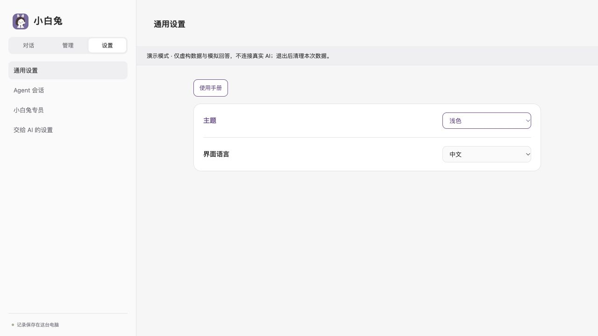
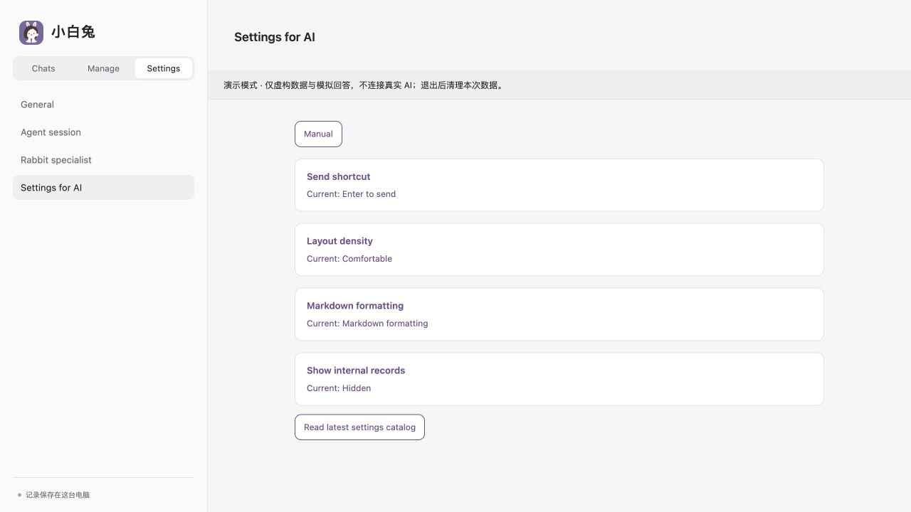

# 设计原则

[English](design.md) · [简体中文](design.zh-CN.md) · [首页](../README.zh-CN.md)

小白兔希望从一个地方联系不同 Agent，同时让身份、数据和能力仍然清楚。设计围绕三个要求：保留原生工作，让 AI 处理已接通的管理操作，把部件做成可以独立复用的模块。

## 一个入口，继续原来的工作

Agent 是执行任务的程序，大模型是它调用的服务。AI 配置保存受支持的组合，记忆配置独立决定额外带入的长期资料；几个选择彼此分开，不表示任意模型都能搭配任意 Agent。

入口应帮助人找到正在做的工作、查看状态，并在支持时继续同一原生会话。读取历史、恢复保存的会话和控制外部存活执行者分别记录。当前宿主主要管理自己的连接，外部桌面任务的直接连接还没有补齐。

设备目标是把这个入口延伸到工作所在的地方。现有手机通路通过 IM.codes 打开同一台在线 Mac；跨电脑调度和唤醒仍是后续目标，不是界面里已经隐藏实现的功能。

## 少量控件，可读的设置目录

常用操作保持可见：输入、发送、选择保存配置，以及常用外观设置。低频操作有可靠程序接口后，再放到次级菜单或可读目录。

例如，**交给 AI 的设置**列出 Markdown 排版、内部记录显示的当前值和允许值，不再为每项增加开关。人可以阅读说明，直接告诉专员要怎么改。

它不是任意配置编辑器。专员读取当前定义和版本，只提交受支持字段，发生冲突后重读；目录与接口共用定义，不能靠一段说明文字冒充已经实现的操作。

## 紫色和中性色是接口信息

| 条目 | 人怎么用 | AI 怎么用 |
| --- | --- | --- |
| 紫色 | 阅读或使用已提供的操作 | 通过已实现的 API、协议或工具读取同一内容／完成对应操作 |
| 黑色／中性色 | 使用当前界面，或亲自确认 | 当前未提供直接程序通路，或该步骤仍需人处理 |
| 紫色设置文档 | 阅读允许值，提出修改要求 | 使用列出的有限接口，不需要逐项图形开关 |

含义作用于完整条目：标题、说明、当前值、可读正文和相应控件一起继承，不是分别装饰按钮。深色主题的人用部分采用可读中性色，不要求字面上的黑色。

紫色也可以表示只读程序访问，不代表每个字段都能写、不代表已经执行成功，也不额外授权。登录、授权和原生审批仍保留各自的人确认通路。

*主题有共用程序接口；界面语言只属于当前浏览器，保留人用的中性色。截图使用虚构演示模式。*

*低频设置保留当前值与说法示例，由专员按同一设置合同执行修改。此图显示基础英文标签。*

## 程序直连与原应用操作

有成熟 CLI、SDK 或协议时优先直连。目标中的补充路线，是让专员利用受支持的界面工具，在原应用中完成一条窄任务，并保留原会话与结果来源。

当前只有**纯程序接口**可用。AI 接口、混合接口仍标为待接入。看到工具目录、安装了某个应用或做过桌面试验，都不足以证明代操作已经接通。

## 结构清楚也是成果

核心各有包、输入、输出和失败状态。身份、能力、执行、显示尽量分开；替换一块时，其他块尽量少改。数据只有明确归属，必要的共同事务保留在一起。

目前已拆出六个核心，仍有宿主装配。先复用现有接口，再考虑新增服务、Agent 循环、设置库或通用编排框架。见[模块与复用](../ARCHITECTURE.md)、[小白兔专员](specialist.zh-CN.md)。
