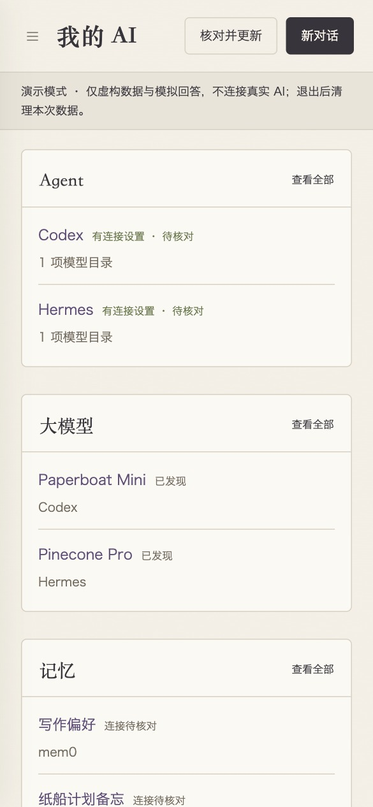
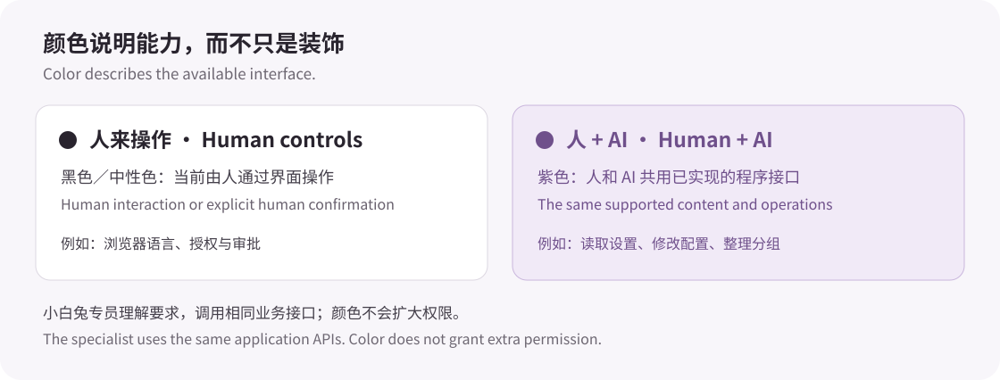
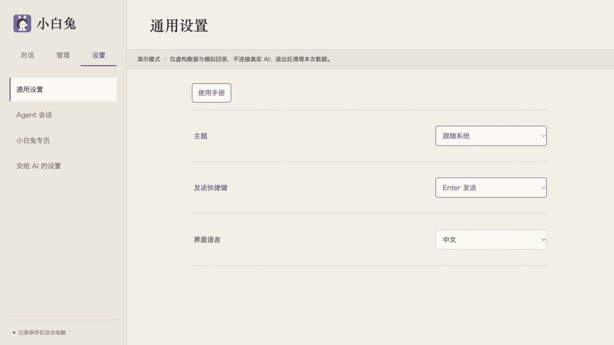
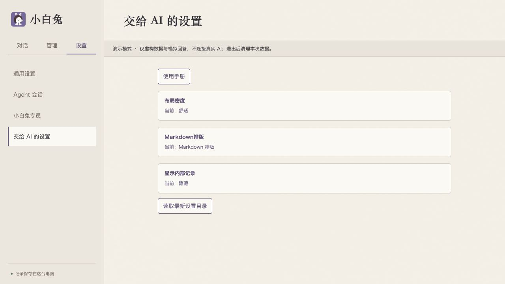

# 设计原则

[English](design.md) · [简体中文](design.zh-CN.md) · [首页](../README.zh-CN.md)

小白兔希望从一个地方联系不同 Agent，同时让身份、数据和能力仍然清楚。设计围绕三个要求：保留原生工作，让 AI 处理已接通的管理操作，把部件做成可以独立复用的模块。

0.2.0-alpha.1 早期源码快照已实现下面的路径。原生连接条件与能力分别列明，不从页面外观推断已经接通。

## 四个去处，一套应用

| 去处 | 做什么 | 操作边界 |
| --- | --- | --- |
| 我的 AI | 汇集 Agent、已发现模型、记忆配置与最近工作 | 进入同一资源的管理详情或准确工作条目；新对话进输入框，兔标回总览 |
| 对话 | 开始、搜索、阅读或继续工作 | 按发送才开始；选配置留在原页，刷新保留当前页面与浏览器本机草稿 |
| 管理与设置 | 看资源详情，维护受支持配置 | 来源与核对时间放在详情；零接入提供“接入第一个 Agent” |
| 小白兔专员 | 留在原工作里交代管理任务 | 左上常驻输入，点标题才打开连续历史与指南 |

**我的 AI**打开或轮询只读已存目录、索引和缓存执行事实，不启动 Agent、不探测模型、不读记忆正文。目录发现的模型仍标“已发现”，过时或未知的执行观察不升格为进行中或空闲；明确点**核对并更新**才开始独立报告流程。

*实际运行界面，资源和工作是虚构示例，非设计效果图；请在自己的环境配置并验证。*

专员**核心选择**放在设置中，当前采用人操作的中性色。Codex 与 DSH 在同一应用历史背后保留各自原生会话，成功切换才增加一处分界；下一轮提供缺失正文，不重放历史工具调用。共用接口不表示全部工具、审批和恢复路径可以互换。

## 暖纸、墨紫与苔绿

当前外观采用暖纸底、干净面板、墨紫和克制的苔绿辅助色。标题用系统宋体，正文与控件用系统黑体，代码保持等宽；细边框、小圆角、少阴影，纸纹静态随包提供。深色另配暖灰和柔紫，保持正文可读。

主题集中在 `原型/rabbit_ui/assets/soft_paper.css`，不另造导航或输入逻辑，也不改变已有紫色／中性色的能力边界；苔绿辅助标记不授予 AI 操作，也不代表状态健康。

## 一个入口，继续原来的工作

Agent 是执行任务的程序，大模型是它调用的服务。AI 配置保存受支持的组合，记忆配置独立决定额外带入的长期资料；几个选择彼此分开，不表示任意模型都能搭配任意 Agent。

入口应帮助人找到正在做的工作、查看状态，并在支持时继续同一原生会话。读取历史、恢复保存的会话和控制外部存活执行者分别记录。当前宿主主要管理自己的连接，外部桌面任务的直接连接还没有补齐。

本源码快照已撤设备分类、唤醒占位、手机预览入口与 IM.codes 专用兼容；保留本机网页服务、访问校验、local 记录身份与浏览器草稿，不处理用户另行安装的软件。历史手机访问和未完成的跨设备设想单独存档。**关于 → 一封旧信**读取随包正文，公开历史从同一来源导出，不维护第二份可独立修改的旧信。

Codex、Hermes、Pi、Claude Code、DSH 从新对话草稿到原生续聊保持同一基本输入路径，保留各自的发送、审批和恢复协议。Codex ↔ Hermes 接续使用明确选择的固定文字／文件／原图快照，准备不执行，按发送才新建目标；Codex 局部细调与专员建议也要等原页面按版本保存的回执，才算应用。会话身份、原生协议与受支持材料仍归所选 Agent。

原生对话暂不可用时，仍可在同一条目读取准确绑定的已存文字。只读路径支持分页、刷新、选择来源和保留原草稿返回；Hermes 各来源分开阅读，来源变化需明确重新读取。读已存文字不会启动、恢复或接管 Agent；实时正文缺少可靠消息映射时，仍只保留搜索命中摘要。

打开原应用是另一项操作。本机 Codex 可提供准确原线程链接，目标应用安装和系统跳转按环境核验，其他 Agent 没有通用外开保证。链接能回到原处，不代表获得其中活跃任务的控制权。

## 少量控件，可读的设置目录

常用操作保持可见：输入、发送、选择保存配置，以及常用外观设置。低频操作有可靠程序接口后，再放到次级菜单或可读目录。

例如，**交给 AI 的设置**列出 Markdown 排版、内部记录显示的当前值和允许值，不再为每项增加开关。人可以阅读说明，直接告诉专员要怎么改。

它不是任意配置编辑器。专员读取当前定义和版本，只提交受支持字段，发生冲突后重读；目录与接口共用定义，不能靠一段说明文字冒充已经实现的操作。

## 证据与展示位置是两个维度

| 维度 | 分类 | 告诉读者什么 |
| --- | --- | --- |
| 证据／解释 | 程序事实 · AI 判断 · AI 说明 | 实际观察到什么、AI 据此怎样判断、如何解释这份判断 |
| 展示范围 | 当前操作 · 总览 · 卡片 · 详情 | 同一信息在哪里、以什么层次呈现 |

放在总览里的 AI 说明仍是说明，不会变成新的程序事实。紫色／中性色表达操作通路，不判断哪条结论为真。手动[状态报告](specialist.zh-CN.md#手动状态报告)沿着程序事实 → 一次无工具分析 → 带来源保存报告；刷新复用结果，可以标明依据变化，不自动修设置或重复分析。

配置文案也按这个原则：**从此配置开始新建配置**表示建立新的保存配置，不表示复制原生会话。页面已去掉原来的新对话默认动作，输入框仍是明确选择保存配置的地方。

## 紫色和中性色是接口信息

| 条目 | 人怎么用 | AI 怎么用 |
| --- | --- | --- |
| 紫色 | 阅读或使用已提供的操作 | 通过已实现的 API、协议或工具读取同一内容／完成对应操作 |
| 黑色／中性色 | 使用当前界面，或亲自确认 | 当前未提供直接程序通路，或该步骤仍需人处理 |
| 紫色设置文档 | 阅读允许值，提出修改要求 | 使用列出的有限接口，不需要逐项图形开关 |

含义作用于完整条目：标题、说明、当前值、可读正文和相应控件一起继承，不是分别装饰按钮。深色主题的人用部分采用可读中性色，不要求字面上的黑色。

紫色也可以表示只读程序访问，不代表每个字段都能写、不代表已经执行成功，也不额外授权。登录、授权和原生审批仍保留各自的人确认通路。

*主题有共用程序接口；界面语言只属于当前浏览器，保留人用的中性色。截图使用虚构演示模式。*

*低频设置保留当前值与说法示例，由专员按同一设置合同执行修改。此图显示基础英文标签。*

## 程序直连与原应用操作

有成熟 CLI、SDK 或协议时优先直连。目标中的补充路线，是让专员利用受支持的界面工具，在原应用中完成一条窄任务，并保留原会话与结果来源。

当前只有**纯程序接口**可用。AI 接口、混合接口仍标为待接入。看到工具目录、安装了某个应用或做过桌面试验，都不足以证明代操作已经接通。

## 结构清楚也是成果

核心各有包、输入、输出和失败状态。身份、能力、执行、显示尽量分开；替换一块时，其他块尽量少改。数据只有明确归属，必要的共同事务保留在一起。

目前已拆出六个核心，仍有宿主装配。先复用现有接口，再考虑新增服务、Agent 循环、设置库或通用编排框架。见[模块与复用](../ARCHITECTURE.md)、[小白兔专员](specialist.zh-CN.md)。
