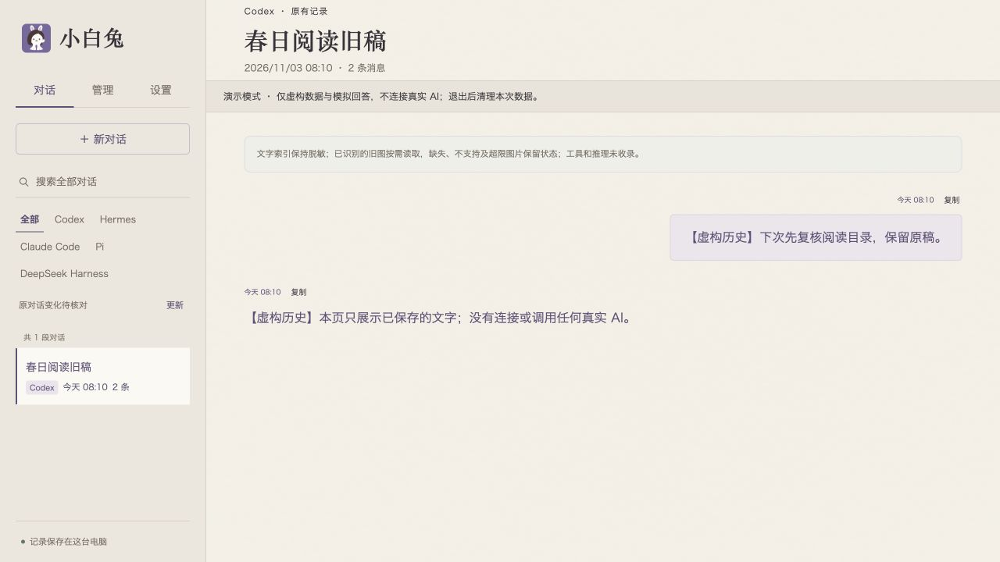

# Connect a native agent

[English](native-agents.md) · [简体中文](native-agents.zh-CN.md) · [Home](../README.md)

Start with **one agent you already use**. White Rabbit's native routes call the agent's own CLI, SDK, or protocol; they do not include a replacement agent or a model account. This snapshot targets macOS/POSIX and Python 3.11+. This is the 0.2.0-alpha.2 early source snapshot; verify authentication and a real same-session exchange in your own environment.

These routes create or recover supported native sessions managed by White Rabbit. They do not automatically attach to a task already running in Codex desktop, WorkBuddy, or any other window. Reading history, recovering a saved session, and controlling a live external executor are separate capabilities.

## Demo and real mode are different

`python3 -B demo.py` uses temporary invented data and rule-based replies. The commands below start the real application: it can index local native histories, store application records, launch agents, and use their current credentials and model settings. A new White Rabbit data directory does not disable native-history discovery. Online agents may transmit the material you send to their providers; normal native startup can also create logs, caches, or background work.

Keep credentials in the original agent's configuration. Do not put them in startup arguments, this repository, chat messages, or project documents.

## Persistent installation

When Codex, Hermes, or DSH is installing for a user, follow [the installation checklist](install-agent.md) to complete one real route first. This JSON contains local paths, not accounts or keys. Put **one of these groups** in `$HOME/.white-rabbit-connections.json`, outside the checkout, replacing every `/absolute/path/to/...` with a verified absolute path. JSON does not expand `$HOME` or `~`.

If the agent uses a custom data directory through `HERMES_HOME` or `DSH_HOME`, add `"home": "/absolute/path/to/that/directory"` to its connection. The login service is not guaranteed to inherit the current shell's variables.

Likewise, model access that relies on variables set only in the current terminal may not be available to the login service. Prefer the agent's own supported persistent login/configuration and verify a real reply after installation. Do not put secrets in this JSON or in chat.

Codex:

```json
{"schema_version":1,"connections":{"codex":{"cli":"/absolute/path/to/codex"}}}
```

Hermes:

```json
{"schema_version":1,"connections":{"hermes":{"node":"/absolute/path/to/node","python":"/absolute/path/to/hermes-agent/venv/bin/python","root":"/absolute/path/to/hermes-agent"}}}
```

Pi:

```json
{"schema_version":1,"connections":{"pi":{"node":"/absolute/path/to/node","cli":"/absolute/path/to/pi-coding-agent/dist/cli.js"}}}
```

Claude Code:

```json
{"schema_version":1,"connections":{"claude":{"python":"/absolute/path/to/claude-sdk-venv/bin/python","cli":"/absolute/path/to/claude"}}}
```

Claude's Python environment also needs the official Claude Agent SDK and the matching `rabbit-runtime`. First check the versions and install the runtime as described under [Claude Code](#claude-code).

DeepSeek Harness:

```json
{"schema_version":1,"connections":{"dsh":{"node":"/absolute/path/to/node","cli":"/absolute/path/to/deepseek-harness/lib/bin.js","root":"/absolute/path/to/deepseek-harness"}}}
```

First choose a stable absolute path to Python 3.11+ as described in the [checklist](install-agent.md) and set it as `RABBIT_PYTHON` in this terminal. From the repository root, preflight and install:

```sh
"$RABBIT_PYTHON" -B 原型/install_local.py check --source-dir "$PWD/原型" --native-config "$HOME/.white-rabbit-connections.json"
"$RABBIT_PYTHON" -B 原型/install_local.py install --source-dir "$PWD/原型" --native-config "$HOME/.white-rabbit-connections.json"
```

Preflight checks basic requirements and paths without starting an agent or calling a model. Authentication, SDK/CLI compatibility, and real conversation still need verification. The installer keeps a private program copy and data under `$HOME/.imcodes/one-ai` and registers a per-user login service; IM.codes is not required. Later, double-click `打开小白兔.command` there. Alternatively run `"/absolute/path/to/python3.11" -B "$HOME/.imcodes/one-ai/manage.py" open`, replacing the example with the absolute Python path selected at installation.

Keep the source checkout for documentation and updates. For an existing installation, omit `--native-config` on update to retain saved connections. Supplying JSON replaces the complete `connections` set; merge existing entries before adding an agent. Updates retain the saved service Python. If it is unavailable, pass `--python "$RABBIT_PYTHON"` explicitly to preflight and installation, and verify Pillow as described in the checklist. Get one real conversation working before adding memory, the specialist, or more agents.

## Foreground debugging command

Run from the repository root. Use a separate development data directory and port, apart from the installed service and the agent's original transcripts:

```sh
"$RABBIT_PYTHON" -B 原型/server.py \
  --data-dir "$HOME/.white-rabbit-dev" \
  --port 17861
```

Append **one of the argument groups below to the same command**. Replace all `/absolute/path/to/...` examples with paths on your own machine. Open <http://127.0.0.1:17861/>, choose the configured native agent/profile, and send a short request deliberately. The base command alone does not enable these native connections.

This mode runs in the current terminal for development or troubleshooting; it does not provide login startup. For the complete current argument list, run `"$RABBIT_PYTHON" -B 原型/server.py --help`.

### Codex

For the basic native route, provide your installed, authenticated Codex CLI:

```sh
--native-codex-cli "/absolute/path/to/codex"
```

To attach White Rabbit's application-management MCP tools instead, use an existing Python environment with the Python `mcp` SDK:

```sh
--native-chat-mcp-python "/absolute/path/to/mcp-venv/bin/python"
```

That route finds Codex through the environment's `PATH`. The two Codex startup flags are mutually exclusive. The management extension changes the available application tools; it is separate from the basic native connection.

### Pi

Provide Node and the CLI script from your installed, configured Pi package:

```sh
--native-pi-node "/absolute/path/to/node" \
--native-pi-cli "/absolute/path/to/pi-coding-agent/dist/cli.js"
```

Both arguments are required together. The connection uses Pi's original RPC and session files. Node requirements follow your Pi installation; the model-capability helper also needs a Node release supporting `--permission`.

### Hermes

Provide a working upstream Hermes environment, including its server dependencies:

```sh
--native-hermes-node "/absolute/path/to/node" \
--native-hermes-python "/absolute/path/to/hermes-agent/venv/bin/python" \
--native-hermes-root "/absolute/path/to/hermes-agent"
```

These three arguments are required together. Use Hermes's own supported Python environment and current native login/configuration. `--native-hermes-home` can explicitly select a Hermes data directory. The optional `--native-hermes-session-settings` enables an additional version-bound settings check; it is off by default.

The generated gateway client is bundled under `原型/rabbit_runtime/hermes/vendor/hermes_gateway/`, together with its MIT notice and upstream fingerprint. Its TypeScript source and build script are included separately. You do not need to rebuild it for normal use; rebuilding checks the exact Node version recorded in `upstream.json`.

### Claude Code

Provide both your installed CLI and a Python environment containing the official Claude Agent SDK:

```sh
--native-claude-python "/absolute/path/to/claude-sdk-venv/bin/python" \
--native-claude-cli "/absolute/path/to/claude"
```

This snapshot's connection checks **Claude Agent SDK 0.2.152** and **Claude CLI 2.1.87** by default. Other versions require an explicit compatibility change, not just a renamed file.

Install this repository's matching `rabbit-runtime` package into that same SDK environment before connecting:

```sh
"/absolute/path/to/claude-sdk-venv/bin/python" -m pip install --no-deps ./原型/rabbit_runtime
```

This command installs the local runtime package; it does not install or update the SDK. The worker checks the installed distribution version and rejects mismatches. Agent installation, credentials, and model settings remain your responsibility; the first send does not silently install missing software.

### DeepSeek Harness

Provide Node, the installed native CLI entry, and the package root:

```sh
--native-dsh-node "/absolute/path/to/node" \
--native-dsh-cli "/absolute/path/to/deepseek-harness/lib/bin.js" \
--native-dsh-root "/absolute/path/to/deepseek-harness"
```

All three arguments are required together. This snapshot's default package-version check is **0.1.0-rc.6**. It uses the original profile, tools, and protocol. Optional `--native-dsh-home` and `--native-dsh-history-root` explicitly select data/history roots; they require the configured native route.

### Management assistant (optional)

Enable the separate management assistant with an existing Python environment containing the `mcp` SDK. The Codex core uses an authenticated Codex CLI; the DSH core reuses the configured native DSH route. This example enables Codex:

```sh
--specialist-mcp-python "/absolute/path/to/mcp-venv/bin/python" \
--specialist-codex-cli "/absolute/path/to/codex"
```

To offer both cores, also configure the native DSH arguments above, preserving its existing account, provider, and profile. Select an available core in **Settings → Rabbit specialist**. Both use the same management MCP and one application history, with separate native sessions; this is not the ordinary composer's AI-profile selection. A supported MCP operation can list a profile, rename its exact ID/current version, and reread the saved result. Check each configured core's real connection and permissions; an ordinary DSH chat route does not automatically configure its specialist role. The optional work-document mode still needs explicit role documents. See [core switching and its limits](specialist.md#switch-the-specialist-core).

The manual **Check and update** report has a separate analysis dependency: an available, already configured Claude text adapter with tools and native session persistence disabled. It analyzes only the four program-supplied metadata facts, records its requested/connection-reported model source, and does not acquire the selected specialist core's management tools. The current report's tool fact observes the Codex-side holder, not all DSH tools. If this optional route is missing, facts can still be saved while the explanation remains incomplete. Refreshing a saved report does not trigger another analysis or change settings. See the [report pipeline](specialist.md#manual-status-report); configuring this route is not required for the first real-agent installation.

## Daily workflow

**Codex, Hermes, Pi, Claude Code, and DSH** share the composer layout from the new-conversation draft into the native conversation. AI profile, read-only memory, interface choice, status badge, and file entry stay together. While an answer is running, the corner button stays Stop; newly typed text remains a draft rather than being queued. Refresh continues the same conversation. File selection is retained when you keep typing during an upload, alongside existing text and materials.

Codex additionally supports model/reasoning adjustments for the unsent new-conversation draft and for one existing conversation. These update the same local setting rather than creating more named profiles or changing the global default. See [draft settings and specialist receipts](specialist.md#codex-draft-and-conversation-settings). Hermes/Pi retain saved-profile selection; their local fine-tuning is later work. Claude can select a saved model configuration without overriding native reasoning. DSH retains native model settings and supports read-only memory selection; its model-writing interface remains unavailable.

On **My AI**, expand the agent list to open an agent’s details. Use **Management** for models and memory. **New conversation** opens the composer. Choose **Home** in the sidebar to return to the dashboard. If the agent list is empty, use its connection guide. Opening or polling the overview reads saved directories and caches, without starting an agent, probing a model, or reading memory content. Use **Check and update** explicitly for a new report. Select existing conversations from the sidebar. Rename and connection maintenance are in the current conversation’s **More** menu; **Settings → Connection and recovery** keeps the low-frequency recovery entry. An uncertain creation retains its original ID for explicit checking; it does not resend a message. Search opens the matched item itself. If an indexed match cannot locate the current native text, its excerpt stays in that item’s **More → Search match**, without redirecting to another conversation.

### Read, continue, or open the original

These actions are distinct: **Continue** uses a supported native-session binding; **Read** opens exactly bound saved text without starting an agent; **Open in Codex** uses a link to the original local Codex thread. The installed application and system handoff need environment-specific verification. An original-app link is navigation, not takeover of its running task, and other agents have no universal external-opening guarantee.

The read-only view keeps paging, source identity, explicit rereading after a source change, and return to the original draft. Hermes sources stay separate; an unmapped live message retains its search excerpt rather than inventing a full-body association.



*Running application with invented resources and work, not a design mockup. Configure and verify it in your own environment.*

### Continue between Codex and Hermes

1. In a Codex or Hermes conversation, choose **More → Continue with another AI** (`更多 → 换 AI 接着聊`). Choosing the other agent's saved profile enters the same path.
2. Select the already read messages, registered complete files, and original images you want to carry. Preview the fixed versions and prepare the continuation draft. Preparation does not create a target conversation or call a model.
3. Review the AI and memory profiles in that draft. **Send** creates the new native conversation and submits the selected versions. Unselected material, native tool state, approvals, and long-term memory are not silently copied; any selected memory is handled separately.
4. Use the source/return entry to go back to the exact original conversation. Browser-local preparation and the source's unsent draft are retained across navigation and refresh.

This new bidirectional workflow currently covers **Codex ↔ Hermes**. It preserves provenance and complete selected file/image versions, not a shared native identity or complete internal-state migration. If creation or sending is uncertain, retain and check the original ID/target; do not create a replacement conversation or resend. Other agents keep their existing handoff routes. Phone-preview compatibility is historical and is not part of this snapshot's supported workflow.

## What to expect

Text conversations, compatible full-text materials, and session continuation have implementations for the five routes. Recovery depends on the original session, working directory, and native files remaining available.

| Route | Saved next-turn settings | Material / result boundary |
| --- | --- | --- |
| Codex | Model/reasoning adjustment for an unsent draft or one conversation; saved profiles remain available | Full text; original images only for supported configurations; new continuation with Hermes |
| Hermes | Model and supported reasoning level through saved profiles | Full text and compatible images; new continuation with Codex; complete exact results can be saved after first successful retrieval |
| Pi | Model and supported reasoning level through saved profiles | Full text; image use needs a verified vision-capable model and route; complete exact results can be saved after first successful retrieval |
| Claude Code | Model selection; reasoning retains native settings | Full text; images are not enabled here; eligible final SDK results can be read from bounded local receipts after disconnect |
| DeepSeek Harness | Local model override remains unconnected because the existing native setter may change global defaults | Full text and next-turn read-only memory selection; images are not enabled here |

The five routes can independently select supported read-only memory for the next turn. Hindsight, Hermes document memory, and the optional Mem0 bridge have different configuration and read/write capabilities. A selected memory profile does not erase context already in the native session or disable the agent's own memory system.

Native target input/result routes are not equivalent to every complete specialist delegation path being validated. Keep the original request/session/turn identity when reading a result; a recent answer is not an exact result. Missing or cold connection state must not trigger an automatic resend.

Claude's local operation ledger can contain **final-answer text**, not only status metadata. It stores only successful, non-truncated, top-level SDK Results with UTF-8 text at most 128 KiB, together with SHA-256 and the original chat/client/session/epoch identity. Matching reads after disconnect or rebuild are labeled `stored_sdk_result`; they do not assert that the original connection is currently alive. Older receipts without stored text are not backfilled, and failures, subtasks, truncated/oversized results, corruption, or identity mismatch cannot be returned as a successful stored answer.

Pi/Hermes also save an eligible complete result **after its first exact successful retrieval**. The original task ID can then read that saved result after service reconstruction, without starting another agent. An interruption before this first successful read can still leave the answer unavailable. Stored results describe a previous completion, not a live connection; missing evidence is not rebuilt from the latest answer. None of these limited saved bodies replaces the native transcript or restores complete internal state.

Agents preserve their own transcripts, tools, permissions, and configurations. A selected text/material handoff does not migrate complete internal state. Offline tests, a successful connection, and a finished real task are different evidence; this release does not promise every tool, extension, approval shape, or recovery case.

The server binds to loopback and keeps its local access checks. Device/wake-up/phone-preview entries and IM.codes-specific compatibility have been removed from this source snapshot. It is not a public hosted service or cross-computer scheduler; separately installed user software and old records are not deleted.

## Observe current work and HAPI (optional)

**Management → Agent → Current work** shows metadata for native connections White Rabbit already owns. Opening an item returns to the same conversation. An empty list does not prove other applications or background tools are idle.

If you already run a local HAPI Hub, the included connector can manually bind its read-only work-discovery route:

```sh
"$RABBIT_PYTHON" -B 工具/hapi_work_connect.py --origin http://127.0.0.1:3006
```

Replace the port with your Hub's port. The tool accepts only a literal loopback HTTP origin, asks for the original HAPI access token without echoing it, and exchanges it for a JWT kept in White Rabbit's memory. Use `--rabbit-port` if the White Rabbit server uses another port. No HAPI process or agent is started by the connector.

Click the manual refresh action under **Management → Agent** to fetch Hub-reported summaries; opening an item goes to HAPI's original page. The statuses are HAPI reports, not proof of White Rabbit control or full native state. Sending, approvals, and stopping remain in HAPI. Service restart or expired authentication needs a fresh manual connection; `--clear` removes only White Rabbit's in-memory binding.
