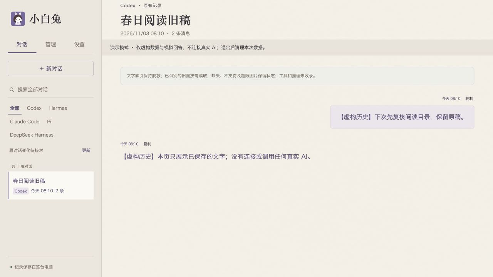

# 连接原生 Agent

[English](native-agents.md) · [简体中文](native-agents.zh-CN.md) · [首页](../README.zh-CN.md)

先选**一个你已经在使用的 Agent**。小白兔通过它原来的 CLI、SDK 或协议连接，不另外提供替代 Agent 或模型账号。当前源码面向 macOS／POSIX，需要 Python 3.11+。这是 0.2.0-alpha.1 早期源码快照，请在自己的环境核对账号认证，并试一次真实回答和同会话续聊。

这些接入方式可以创建或恢复小白兔支持、并由它管理的原生会话，不会自动接上 Codex 桌面、WorkBuddy 或其他窗口里正在执行的任务。能读历史、能恢复保存的会话，以及能控制外部正在运行的任务，是三种不同能力。

## 演示与真实模式不同

`python3 -B demo.py` 使用临时虚构资料和规则回复。下面启动的是真实应用：它可以为本机原生历史建索引，保存应用记录，启动 Agent，并使用现有登录信息和模型设置。新建小白兔数据目录，并不会关闭原生历史发现。在线 Agent 会把你发送的材料传给所选服务，原生启动也可能写日志、更新缓存或产生后台任务。

登录凭据继续留在原 Agent 的配置中，不写进启动参数、仓库、聊天或项目说明。

## 持久安装

让 Codex、Hermes 或 DSH 帮你安装时，先按[安装清单](install-agent.zh-CN.md)接通一个 Agent 并实际聊通。下面的 JSON 只记录本机路径，不存账号或 Key。**任选一组**写到仓库外的 `$HOME/.white-rabbit-connections.json`，把所有 `/absolute/path/to/...` 换成已核实的绝对路径。JSON 内不会展开 `$HOME` 或 `~`。

如果平时用 `HERMES_HOME` 或 `DSH_HOME` 指定资料目录，还要在对应连接中写入 `"home": "/该目录的绝对路径"`。登录启动服务不保证能读到当前终端的变量。

如果原 Agent 的模型服务只靠当前终端里的环境变量连接，登录启动服务也未必能读取这些变量。优先用该 Agent 自己支持的长期登录／配置方式，安装后再用真实回复核对。不要把密钥写入这个 JSON 或对话。

Codex：

```json
{"schema_version":1,"connections":{"codex":{"cli":"/absolute/path/to/codex"}}}
```

Hermes：

```json
{"schema_version":1,"connections":{"hermes":{"node":"/absolute/path/to/node","python":"/absolute/path/to/hermes-agent/venv/bin/python","root":"/absolute/path/to/hermes-agent"}}}
```

Pi：

```json
{"schema_version":1,"connections":{"pi":{"node":"/absolute/path/to/node","cli":"/absolute/path/to/pi-coding-agent/dist/cli.js"}}}
```

Claude Code：

```json
{"schema_version":1,"connections":{"claude":{"python":"/absolute/path/to/claude-sdk-venv/bin/python","cli":"/absolute/path/to/claude"}}}
```

Claude 的 Python 环境还需要官方 Claude Agent SDK 和同版 `rabbit-runtime`。先按下面 [Claude Code 的说明](#claude-code)核对版本并安装运行包。

DeepSeek Harness：

```json
{"schema_version":1,"connections":{"dsh":{"node":"/absolute/path/to/node","cli":"/absolute/path/to/deepseek-harness/lib/bin.js","root":"/absolute/path/to/deepseek-harness"}}}
```

先按[安装清单](install-agent.zh-CN.md)选一个稳定的 Python 3.11+ 绝对路径，在当前终端设为 `RABBIT_PYTHON`。然后在仓库根目录检查并安装：

```sh
"$RABBIT_PYTHON" -B 原型/install_local.py check --source-dir "$PWD/原型" --native-config "$HOME/.white-rabbit-connections.json"
"$RABBIT_PYTHON" -B 原型/install_local.py install --source-dir "$PWD/原型" --native-config "$HOME/.white-rabbit-connections.json"
```

预检只检查基础环境和路径，不启动 Agent，也不调用模型。之后还要核对登录、SDK／CLI 是否兼容，并实际聊一次。安装器把私有程序副本和数据放在 `$HOME/.imcodes/one-ai`，设为当前用户登录后启动，不需要另外安装 IM.codes。以后双击该目录的 `打开小白兔.command` 即可。也可用安装时选定的 Python 绝对路径运行 `"/absolute/path/to/python3.11" -B "$HOME/.imcodes/one-ai/manage.py" open`，把示例路径换成实际路径。

保留源码目录，以便查看文档和更新。更新已有安装时，省略 `--native-config` 就能保留原连接。传入 JSON 会完整替换 `connections`，所以添加新 Agent 前，要先合并原有条目。更新默认继续用已保存的服务 Python。旧路径不能用时，在预检和安装中加上 `--python "$RABBIT_PYTHON"` 明确更换，并按安装清单核对 Pillow。先让一个 Agent 真正聊通，再配记忆、专员或其他 Agent。

## 前台调试命令

在仓库根目录运行。另用一个调试数据目录和端口，不要与已安装服务或 Agent 的正文目录混用：

```sh
"$RABBIT_PYTHON" -B 原型/server.py \
  --data-dir "$HOME/.white-rabbit-dev" \
  --port 17861
```

把下面**任选一组参数追加到同一条命令末尾**。所有 `/absolute/path/to/...` 都要换成本机路径。打开 <http://127.0.0.1:17861/>，选择已配置的原生 Agent／配置，明确发送一条简短请求。只运行基础命令，不会启用这些原生连接。

这种方式在当前终端前台运行，方便开发或排查，不负责登录启动。完整参数请看 `"$RABBIT_PYTHON" -B 原型/server.py --help`。

### Codex

基础原生接入只需提供已安装、已登录的 Codex CLI：

```sh
--native-codex-cli "/absolute/path/to/codex"
```

如果还要加上小白兔的应用管理 MCP 工具，改用装有 Python `mcp` SDK 的解释器：

```sh
--native-chat-mcp-python "/absolute/path/to/mcp-venv/bin/python"
```

这个方式通过环境的 `PATH` 找到 Codex。两种 Codex 启动参数不能同时指定，管理扩展与基础原生连接也是两种不同方式。

### Pi

提供已安装、配置好的 Pi 所用的 Node 和 CLI 脚本：

```sh
--native-pi-node "/absolute/path/to/node" \
--native-pi-cli "/absolute/path/to/pi-coding-agent/dist/cli.js"
```

两项必须一起提供，继续使用 Pi 的原生 RPC 和会话文件。Node 版本要满足所选 Pi 的要求，模型能力查询 helper 还需要支持 `--permission` 的 Node。

### Hermes

需要能正常运行的上游 Hermes 环境，包括它的服务端依赖：

```sh
--native-hermes-node "/absolute/path/to/node" \
--native-hermes-python "/absolute/path/to/hermes-agent/venv/bin/python" \
--native-hermes-root "/absolute/path/to/hermes-agent"
```

三项必须一起提供，使用 Hermes 自己支持的 Python 环境、登录和配置。可用 `--native-hermes-home` 指定资料目录。`--native-hermes-session-settings` 会额外核对特定版本的设置，默认关闭。

包内 `原型/rabbit_runtime/hermes/vendor/hermes_gateway/` 保留生成的通信客户端、MIT 许可和上游指纹，还附有 TypeScript 源码和构建脚本。普通使用不用重新构建。重新构建时，会核对 `upstream.json` 记录的精确 Node 版本。

### Claude Code

同时提供原有 CLI 和已安装官方 Claude Agent SDK 的 Python：

```sh
--native-claude-python "/absolute/path/to/claude-sdk-venv/bin/python" \
--native-claude-cli "/absolute/path/to/claude"
```

此快照默认核对 **Claude Agent SDK 0.2.152** 和 **Claude CLI 2.1.87**。其他版本需要明确适配，不能只改文件名绕过。

连接前，在安装 SDK 的同一个 Python 环境中，安装本仓库的同版 `rabbit-runtime`：

```sh
"/absolute/path/to/claude-sdk-venv/bin/python" -m pip install --no-deps ./原型/rabbit_runtime
```

这条命令只安装本地运行包，不安装或升级 SDK。工作进程会核对已安装包的版本，不匹配就拒绝启动。Agent、账号和模型配置需要自行准备，第一次发送不会悄悄安装缺少的软件。

### DeepSeek Harness

提供 Node、已安装的原生 CLI 入口和包根目录：

```sh
--native-dsh-node "/absolute/path/to/node" \
--native-dsh-cli "/absolute/path/to/deepseek-harness/lib/bin.js" \
--native-dsh-root "/absolute/path/to/deepseek-harness"
```

三项必须一起提供。此快照默认核对包版本 **0.1.0-rc.6**，继续使用原生 profile、工具和协议。可用 `--native-dsh-home`、`--native-dsh-history-root` 指定资料／历史目录，但必须与已配置的原生入口一起使用。

### 小白兔专员（可选）

独立管理专员需要装有 `mcp` SDK 的 Python。Codex 核心使用已登录的 Codex CLI，DSH 核心使用已配置的原生 DSH 接入。下例启用 Codex：

```sh
--specialist-mcp-python "/absolute/path/to/mcp-venv/bin/python" \
--specialist-codex-cli "/absolute/path/to/codex"
```

如果要同时提供两种核心，再配上面的原生 DSH 参数，继续使用它的账号、提供商与 profile。在**设置 → 小白兔专员**选择已接通核心。两者共用管理 MCP 和同一份应用历史，但各自保留原生会话，这与普通输入框选 AI 配置不同。支持的 MCP 操作可以列配置，按准确编号／当前版本改名，再读回。请核对每个已配置核心的实际连接与权限，普通 DSH 聊天接入不会自动配置它的专员角色。可选工作说明模式仍需明确提供角色文档。见[换核及其边界](specialist.zh-CN.md#切换专员核心)。

手动**核对并更新**报告还需要已有、可用的 Claude 文字适配器。这条分析连接关闭工具和原生对话持久化，只分析程序给定的四项元数据，记录请求／连接报告的型号来源，不取得所选专员核心的管理工具。目前报告的工具一项仍只查看 Codex 一侧，不覆盖所有 DSH 工具。没有这条可选连接时，仍能保存程序事实，说明标为未完成。刷新旧报告不会重新分析或改设置。见[报告流程](specialist.zh-CN.md#手动状态报告)。首次安装只需先聊通一个真实 Agent，不要求先配置这条分析连接。

## 日常操作

**Codex、Hermes、Pi、Claude Code、DSH**从新对话草稿到原生对话，使用同一套输入区。AI 配置、只读记忆、接口方式、铭牌和文件入口放在一起。回答过程中，右下角一直显示停止，此时新输入只保留为草稿，不会排队发送。刷新后继续原会话。上传文件时仍能打字，选入的文件、原文字和已有材料都会保留。

Codex 还可调整未发送的新对话草稿或一段已有对话的模型／强度，只更新同一份局部设置，不会不断增加命名配置，也不改全局默认。见[草稿设置与专员回执](specialist.zh-CN.md#codex-草稿与本对话细调)。Hermes／Pi 仍选择保存配置，局部细调以后再做。Claude 可选保存的模型配置，不覆盖原生强度。DSH 继续用原生模型设置，可以选择只读记忆，模型写入口仍留空。

从**我的 AI**出发：点 Agent／模型／记忆摘要，就能进入对应资源的管理详情，也可直接选择最近工作的操作。**新对话**打开原输入框，兔标回总览，还没接入时先**接入第一个 Agent**。总览打开或定时更新时，只读已有目录和缓存，不启动 Agent，也不探测模型或读取记忆正文。需要新报告时，明确点**核对并更新**。已有对话也能从侧栏选择。改名和连接维护放在当前对话“更多”里，“设置 → 连接与恢复”保留不常用的恢复入口。创建结果不明时，沿原编号手动核对，不重新发送消息。搜索打开命中的条目本身。索引命中无法准确对应到当前原生正文时，摘要留在本条目的“更多 → 搜索命中”，不跳到另一段对话。

### 阅读、继续与打开原处

三种操作分别提供：**继续**使用支持的原生会话绑定。**阅读**只打开准确对应的已存文字，不启动 Agent。**在 Codex 打开原对话**使用本机原线程链接。请在自己的环境确认目标应用已安装，系统也能正确跳转。打开原处只是导航，不会因此接管正在运行的任务，其他 Agent 不保证都能这样打开。

只读页可以分页并查看来源，来源变了需要明确重新读取，返回时保留原草稿。Hermes 各来源分开显示。实时消息无法可靠对应时，只保留搜索摘要，不补造全文关联。



*实际运行界面，资源和工作是虚构示例，非设计效果图；请在自己的环境配置并验证。*

### 在 Codex 与 Hermes 之间接着聊

1. 在 Codex 或 Hermes 对话中，点**更多 → 换 AI 接着聊**。选择另一位 Agent 的保存配置，也会进入同一流程。
2. 选择要带上的已读消息、已登记完整文件和原图，按固定版本预览，再准备接续草稿。准备时不创建目标对话，也不调用模型。
3. 在草稿里核对 AI 和记忆配置，**按发送**才新建原生对话，提交选定版本。没选的材料、原生工具状态、审批和长期记忆都不会自动复制，所选记忆另按配置处理。
4. 从来源／返回入口回到准确原对话。准备内容只存在当前浏览器，切页和刷新后仍能继续，原对话的未发草稿也保留。

这条双向接续流程目前只覆盖 **Codex ↔ Hermes**。它保留来源，以及选定的完整文件／原图版本，不共用原生身份，也不迁移完整内部状态。创建或发送结果不明时，保留原编号和原目标核对，不另建或重发。其他 Agent 保留已有交接方式。手机预览兼容已转为历史，不属于本快照支持的日常流程。

## 使用边界

五种接入方式都已有文字对话、兼容的完整文本材料和继续会话的实现。恢复时，原会话、工作目录和原生资料必须仍然可用。

| 通路 | 下轮保存配置 | 材料／结果边界 |
| --- | --- | --- |
| Codex | 新对话草稿／本对话可细调模型与强度，也保留保存配置入口 | 完整文本。只在支持的指定配置下开放原图，可与 Hermes 接续 |
| Hermes | 通过保存配置选择模型与支持的强度 | 完整文本与兼容原图，可与 Codex 接续。完整准确结果可在首次成功读取后保存 |
| Pi | 通过保存配置选择模型与支持的强度 | 完整文本。图片需要已验证的视觉模型和接入方式，完整准确结果可在首次成功读取后保存 |
| Claude Code | 选择模型，强度沿用原生 | 完整文本，图片未开放。符合条件的 SDK 最终结果，可在断开后从大小受限的本机回执读回 |
| DeepSeek Harness | 局部模型覆盖还没接通，因为现有原生设置接口可能修改全局默认 | 完整文本及下轮只读记忆选择，图片未开放 |

五种接入方式都能为下一轮单独选择支持的附加只读记忆。Hindsight、Hermes 文档记忆和可选 Mem0 桥，需要的配置和读写能力各不相同。选择记忆不会清除原生会话已有的上文，也不是关闭原 Agent 全部记忆的开关。

有原生目标输入／结果接口，不表示完整的专员交办流程都已验收。读取结果时必须核对原请求、会话和轮次身份，不能拿最近一条回答代替。没有现成连接（冷连接）或缺少缓存时，也不能自动补发。

Claude 的本机操作账本可以保存**最终回答正文**，不只是状态元数据。只保存成功、未截断、不属于子任务的顶层 SDK Result，UTF-8 正文最多 128 KiB，同时核对 SHA-256 及原 chat／client／session／epoch 身份。断开或重建后，匹配的读回结果标为 `stored_sdk_result`，不表示原连接当前还活着。旧回执没有正文就不补写。失败、子任务、截断／超限、损坏或身份不符的结果，都不能当作成功的存储回答。

Pi／Hermes 也会在**首次按原编号成功取回完整结果后**保存符合条件的答案，服务重建后可按原任务编号读取，不必启动另一位 Agent。第一次成功读取前中断，仍可能读不到答案。保存的结果只说明先前已完成，不表示当前还有活连接。缺少结果时，不从最近一条回答补造。这些有限正文不能代替完整原生历史，也不能恢复全部内部状态。

Agent 仍保留自己的正文、工具、权限和配置，交接材料不会迁移完整内部状态。离线测试通过、连接成功、真实任务完成，要分开判断。本版不承诺所有工具、扩展、审批和恢复情况都已覆盖。

服务只监听本机，保留本机访问校验。本源码快照已撤设备／唤醒／手机预览入口和 IM.codes 专用兼容，不提供公开托管或跨电脑调度，也不会删除用户另外安装的软件或旧记录。

## 查看当前工作与 HAPI（可选）

**管理 → Agent → 当前工作**显示小白兔已经建立的原生连接的基本信息（元数据），点条目回到同一对话。列表为空，不能说明其他应用或后台工具都已空闲。

如果你已经使用本机 HAPI Hub，可以用随包工具手动接上只读工作发现功能：

```sh
"$RABBIT_PYTHON" -B 工具/hapi_work_connect.py --origin http://127.0.0.1:3006
```

把端口换成实际 Hub 端口。工具只接受明确的本机 HTTP 地址，会在终端询问原 HAPI access token，输入时不回显。交换得到的 JWT 只放在小白兔内存。小白兔服务用了别的端口时，追加 `--rabbit-port`。工具不启动 HAPI 或 Agent。

在**管理 → Agent**手动刷新，可读取 Hub 报告的工作摘要，点条目会打开 HAPI 原页面。状态只代表 HAPI 的报告，不能说明小白兔已经控制工作或读到了全部原生状态。发送、审批和停止仍在 HAPI 里处理。服务重启或认证过期后，需要手动重连。`--clear`只清除小白兔内存中的绑定。
